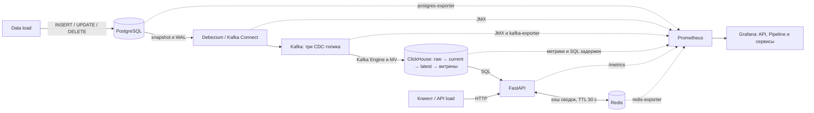

# Realtime-1 Capstone

Проект собирает изменения заказов, их позиций и платежей из PostgreSQL
через Debezium и Kafka в ClickHouse. API возвращает сводки по заказам,
кампаниям и товарам, а также временные ряды заказов и платежей.
Prometheus собирает метрики сервисов и доставки данных, Grafana отображает их.

Проект выполнен в рамках курса [NewProLab Realtime Analytics](https://github.com/newprolab/realtime-1).
Схема PostgreSQL и генератор данных адаптированы из материалов курса.



Сплошные стрелки показывают путь данных, пунктирные — сбор метрик.

## Структура проекта

Код и конфигурация стенда находятся в корне репозитория:

```text
realtime-1-capstone/
├── compose.yaml          # контейнеры и volumes данных
├── justfile              # запуск, диагностика и нагрузка
├── Dockerfile            # образ API
├── pyproject.toml        # зависимости; версии закреплены в uv.lock
├── .env.example          # настройки портов
├── src/
│   ├── postgres/         # таблицы, роли и начальные данные
│   ├── debezium/         # конфигурация CDC
│   ├── clickhouse/
│   │   ├── setup/        # raw, current, latest и MV
│   │   └── metrics/      # бизнес-витрины
│   ├── api/              # FastAPI, SQL-запросы, кэш и метрики
│   ├── generator/        # генераторы данных и API-запросов
│   └── demo/             # сценарии snapshot, CDC и повторов в Kafka
└── monitoring/
    ├── prometheus.yml    # сбор метрик
    ├── alerts.yml        # алерты
    ├── postgres/         # настройки postgres-exporter
    ├── jmx/              # метрики Kafka и Connect
    ├── clickhouse/       # метрики ClickHouse и задержек доставки
    └── grafana/          # дашборды и provisioning
```

В `src/` находятся SQL-скрипты, конфигурация Debezium, код API и генераторы
нагрузки. В `monitoring/` — конфигурация Prometheus, экспортеров и Grafana,
правила алертов и дашборды.

`compose.yaml` описывает сервисы, сеть и volumes. Команды запуска, настройки
и диагностики собраны в `justfile`.

## Быстрый старт

Для запуска нужны Docker с Compose v2, just, uv и Python 3.12 или новее.
Теги образов заданы в `compose.yaml` и Dockerfile, версии Python-зависимостей —
в `uv.lock`. Первый запуск скачивает образы, пакеты из PyPI и JMX-агент с GitHub.

Склонируйте репозиторий и проверьте занятые порты.
Если репозиторий уже скачан, перейдите в его каталог и пропустите `git clone`:

```sh
git clone https://github.com/rmnfl/realtime-1-capstone.git
cd realtime-1-capstone
docker ps --format 'table {{.Names}}\t{{.Status}}\t{{.Ports}}'
lsof -nP -iTCP:55434 -iTCP:19093 -iTCP:28084 -iTCP:18133 -iTCP:18001 -iTCP:19005 -iTCP:13005 -sTCP:LISTEN
```

При конфликте портов скопируйте [.env.example](.env.example) в `.env` и измените
нужные значения. `just` загружает этот файл автоматически. Во всех примерах
README используются порты по умолчанию.

```sh
just up
just status
just cdc-status
```

На пустом volume PostgreSQL выполняет [00-init.sql](src/postgres/00-init.sql),
затем [01-seed.sql](src/postgres/01-seed.sql). `just up` создаёт таблицы
и представления ClickHouse, регистрирует коннектор Debezium и запускает API
с мониторингом. Коннектор сначала делает начальный снимок таблиц (snapshot),
затем читает изменения из WAL.

В выводе `just cdc-status` коннектор и задача должны иметь статус `RUNNING`.
Начальные показатели появятся в API после обработки snapshot; ожидаемые
значения приведены в разделе «Исходный snapshot».

| Сервис | Адрес с хоста |
|---|---|
| API: Swagger UI | [localhost:18001/docs](http://localhost:18001/docs) |
| Grafana | [localhost:13005](http://localhost:13005) |
| Prometheus | [localhost:19005](http://localhost:19005) |
| Kafka Connect REST API | [localhost:28084/connectors](http://localhost:28084/connectors) |
| ClickHouse HTTP | `localhost:18133` |
| PostgreSQL | `localhost:55434`, база `capstone` |
| Kafka | `localhost:19093` |

Учебные учётные записи:

| Сервис и назначение | Пользователь | Пароль |
|---|---|---|
| PostgreSQL: администратор стенда | `user` | `password` |
| PostgreSQL: чтение CDC | `debezium` | `debezium` |
| PostgreSQL: мониторинг | `monitor` | `monitor` |
| ClickHouse: администратор | `admin` | `password` |
| ClickHouse: чтение из API и мониторинга | `reader` | `reader` |
| Grafana | `admin` | `admin` |

Файл `.env` и реальные секреты в Git не добавляются.

```sh
just down              # удалить контейнеры и сеть, сохранить volumes и offsets
just start             # запустить уже подготовленный стенд
just down --volumes    # удалить также volumes: данные, offsets и историю метрик
```

На существующем volume PostgreSQL не выполняет init-скрипты повторно.
`just setup` создаёт отсутствующие таблицы и бизнес-витрины ClickHouse
через `IF NOT EXISTS`; изменения их определений нужно применять отдельно.
Представление `pipeline_metrics` для мониторинга обновляется через
`CREATE OR REPLACE VIEW`.

`just down` сохраняет volumes PostgreSQL, Kafka и ClickHouse, в том числе
позиции чтения CDC. С флагом `--volumes` удаляются и volumes стенда;
для следующего запуска с нуля используйте `just up`.
Кэш Redis при удалении контейнера не сохраняется.

## Контракт данных

База и схема PostgreSQL называются `capstone`. Идентификаторы имеют тип `TEXT`,
временные метки — `TIMESTAMPTZ`, суммы и цены — `BIGINT` в целых копейках.
DDL находится в [00-init.sql](src/postgres/00-init.sql).

В каждой таблице первичный ключ — `(dataset_id, id)`. Поэтому один и тот же
`id` можно использовать в разных датасетах. Позиции и платежи связаны с заказом
составным внешним ключом `(dataset_id, order_id)`.

```text
orders
  dataset_id       TEXT         NOT NULL
  id               TEXT         NOT NULL
  campaign_id      TEXT         NOT NULL
  status           TEXT         NOT NULL
  amount_cents     BIGINT       NOT NULL
  version          INTEGER      NOT NULL
  created_at       TIMESTAMPTZ  NOT NULL
  updated_at       TIMESTAMPTZ  NOT NULL
  PRIMARY KEY (dataset_id, id)
```

```text
order_items
  dataset_id       TEXT         NOT NULL
  id               TEXT         NOT NULL
  order_id         TEXT         NOT NULL
  sku              TEXT         NOT NULL
  quantity         INTEGER      NOT NULL
  unit_price_cents BIGINT       NOT NULL
  PRIMARY KEY (dataset_id, id)
  FK (dataset_id, order_id) -> orders(dataset_id, id)
```

```text
payments
  dataset_id       TEXT         NOT NULL
  id               TEXT         NOT NULL
  order_id         TEXT         NOT NULL
  kind             TEXT         NOT NULL
  amount_cents     BIGINT       NOT NULL
  occurred_at      TIMESTAMPTZ  NOT NULL
  PRIMARY KEY (dataset_id, id)
  FK (dataset_id, order_id) -> orders(dataset_id, id)
```

В заказах используются статусы `created`, `paid` и `cancelled`.
`amount_cents` — сумма заказа, `created_at` — время создания,
`updated_at` — время последнего изменения. При UPDATE приложение увеличивает
`version` и обновляет `updated_at`; в PostgreSQL это не автоматизировано.

В `order_items` поле `quantity` содержит количество товара,
`unit_price_cents` — цену единицы.
Начальный датасет и генератор считают сумму заказа как сумму
`quantity * unit_price_cents` по его позициям.

В `payments` записываются операции `capture` (оплата) и `refund` (возврат).
Одна строка — одна операция; у заказа может быть несколько таких операций.
`occurred_at` — время операции. Таблица используется как append-only журнал:
записанные операции не изменяются и не удаляются. Обработка UPDATE и DELETE
для платежей в ClickHouse не предусмотрена.

Изменение статуса заказа и запись платежа выполняются отдельными SQL-командами.
В контрольном сценарии они объединены в одну транзакцию PostgreSQL.

## CDC

Конфигурация Debezium находится в [connector.json](src/debezium/connector.json).
Данные начального snapshot и последующие изменения каждой таблицы
попадают в отдельный Kafka-топик:

- `capstone.capstone.orders`;
- `capstone.capstone.order_items`;
- `capstone.capstone.payments`.

Ключ сообщения — JSON с `dataset_id` и `id`. Значение — событие в формате
Debezium envelope с полями `op`, `before`, `after`, `source` и временными метками.

| Операция | `op` | `before` | `after` |
|---|---|---|---|
| Snapshot | `r` | `null` | Строка из снимка таблицы |
| INSERT | `c` | `null` | Новая строка |
| UPDATE | `u` | Старая строка | Новая строка |
| DELETE | `d` | Старая строка | `null` |

После DELETE приходит tombstone — сообщение с тем же ключом и `value=null`.
Порядок сообщений гарантируется внутри партиции. Между топиками и партициями
общего порядка нет.

## ClickHouse

Таблицы `*_cdc_queue` с движком Kafka читают сообщения из топиков.
Инкрементальные материализованные представления (MV) разбирают JSON
при вставке и записывают строки в `orders_raw`, `order_items_raw` и `payments_raw`. Повторная доставка
добавляет в raw ещё одну строку.

Из raw другие MV записывают строки в таблицы `*_current`
с движком ReplacingMergeTree.
При слиянии строк с одинаковым ключом сортировки `(dataset_id, id)`
действуют следующие правила:

| Таблица | Правило замены |
|---|---|
| `orders_current` | Остаётся строка с наибольшей `version` |
| `order_items_current` | Остаётся строка с наибольшим `_source_lsn` — позицией изменения в WAL |
| `payments_current` | Остаётся одна строка по ключу; у повторов должны совпадать бизнес-поля платежа |

Например, после `created` с версией 1 пришёл `paid` с версией 2.
Повторная доставка версии 1 не вернёт заказ в статус `created`.

ReplacingMergeTree оставляет одну версию строки при фоновом слиянии частей данных.
Представления `orders_latest`, `order_items_latest` и `payments_latest`
читают `*_current` с `FINAL`, поэтому выбирают одну версию строки по тем же
правилам, даже если фоновое слияние ещё не произошло. Бизнес-витрины
обращаются к этим представлениям.

DELETE обрабатывается как ещё одна версия строки. Для заказа из `before`
берутся прежние поля, устанавливаются `is_deleted=1` и `version=before.version+1`.
Для позиции сохраняются прежние поля, признак удаления и LSN события.
В PostgreSQL столбца `is_deleted` нет — его добавляет MV.
Витрины сначала выбирают последнюю версию, затем исключают удалённые строки.

Tombstone не записывается в raw: удаление обрабатывается по событию `op=d`.
Для платежей MV принимает только snapshot и INSERT (`op=r` и `op=c`).

В raw также сохраняются метаданные доставки:

| Поле | Содержимое |
|---|---|
| `_source_lsn` | `source.lsn` — позиция изменения в WAL |
| `_source_ts` | `source.ts_ms` — время изменения в PostgreSQL для событий CDC |
| `_debezium_ts` | `ts_ms` на верхнем уровне — время обработки события коннектором Debezium |
| `_ingested_at` | Время обработки строки в MV ClickHouse |
| `_operation` | Значение `op`: r / c / u / d |
| `_kafka_topic`, `_kafka_partition`, `_kafka_offset` | Топик, партиция и offset сообщения |

Координаты Kafka позволяют найти исходное сообщение, временные метки —
рассчитать задержки между этапами доставки. Если `source.ts_ms` или `ts_ms`
на верхнем уровне отсутствует, соответствующее поле времени получает `NULL`.
В current переносится только `_source_lsn`; остальные метаданные остаются в raw.

## API и бизнес-метрики

API предоставляет пять GET-эндпоинтов с общим префиксом
`http://localhost:18001/v1/datasets/{dataset_id}/metrics/`.
Например, сводка заказов датасета `demo` доступна по пути
`/v1/datasets/demo/metrics/orders/summary`.

FastAPI автоматически формирует OpenAPI-схему по маршрутам и моделям параметров.
На её основе строится [Swagger UI](http://localhost:18001/docs), где можно
посмотреть параметры эндпоинтов и выполнить запросы из браузера.

В каждом запросе обязательны `from` и `to` в ISO 8601 с часовым поясом,
например `2026-01-01T00:00:00Z`. Начало периода включается, конец — нет;
длительность периода должна быть больше нуля и не превышать 31 день. API приводит время к UTC.
`dataset_id` должен соответствовать `[a-z0-9][a-z0-9_-]{0,63}`.

В успешном ответе поле `data` содержит результат, а `meta.computed_at` —
время его расчёта.
У `orders/summary` результат — объект со сводкой, у остальных — список записей.
Денежные поля измеряются в копейках; средний чек может иметь дробную часть.

Расчёты используют последние версии записей, доставленные в ClickHouse.

### Заказы — `orders/summary`

Возвращает сводку по заказам, созданным за выбранный период (`orders.created_at`).
Удалённые заказы исключаются. `campaign_id` ограничивает выборку одной кампанией;
`refresh=true` выполняет запрос без чтения кэша.

| Поле | Значение |
|---|---|
| `orders_count` | Общее число заказов в выборке |
| `created_orders_count` | Число заказов со статусом `created` |
| `paid_orders_count` | Число заказов со статусом `paid` |
| `cancelled_orders_count` | Число заказов со статусом `cancelled` |
| `paid_amount_cents` | Сумма `amount_cents` у заказов со статусом `paid` |
| `avg_paid_amount_cents` | `paid_amount_cents / paid_orders_count`; `null`, если оплаченных заказов нет |
| `paid_share` | `paid_orders_count / orders_count`; от 0 до 1, `null`, если заказов нет |
| `cancelled_share` | `cancelled_orders_count / orders_count`; от 0 до 1, `null`, если заказов нет |

При пустой выборке счётчики и сумма равны 0, средний чек и доли — `null`.

### Кампании — `campaigns/summary`

Возвращает показатели для каждой кампании по заказам, созданным за выбранный
период. Удалённые заказы исключаются. Поддерживаются `limit` и `refresh`.

| Поле | Значение |
|---|---|
| `campaign_id` | Идентификатор кампании |
| `orders_count` | Число заказов кампании |
| `created_orders_count` | Число заказов кампании со статусом `created` |
| `paid_orders_count` | Число заказов кампании со статусом `paid` |
| `cancelled_orders_count` | Число заказов кампании со статусом `cancelled` |
| `paid_amount_cents` | Сумма заказов кампании со статусом `paid` |
| `avg_paid_amount_cents` | `paid_amount_cents / paid_orders_count`; `null`, если оплаченных заказов нет |
| `paid_share` | `paid_orders_count / orders_count` для этой кампании |
| `cancelled_share` | `cancelled_orders_count / orders_count` для этой кампании |

Результат отсортирован по убыванию `paid_amount_cents`, затем по возрастанию
`campaign_id`. Параметр `limit` от 1 до 100 ограничивает число кампаний в ответе.
Без него возвращаются все кампании, при пустой выборке — `[]`.

Обе сводки читают [одну витрину](src/clickhouse/metrics/01-campaign-summary.sql).
Для `orders/summary` складываются счётчики и суммы кампаний, затем по этим
итогам рассчитываются средний чек и доли.

### Товары — `products/summary`

Возвращает показатели по SKU из оплаченных заказов. Период задаётся по дате
создания заказа. Удалённые заказы и позиции исключаются.
Поддерживаются `campaign_id`, `limit` и `refresh`.

| Поле | Значение |
|---|---|
| `sku` | Идентификатор товара |
| `paid_orders_count` | Число разных заказов со статусом `paid`, содержащих этот SKU |
| `units_count` | Сумма `quantity` по позициям этого SKU |
| `items_amount_cents` | Сумма `quantity * unit_price_cents` по позициям этого SKU |

Результат отсортирован по убыванию `items_amount_cents`, затем по возрастанию
SKU. Параметр `limit` от 1 до 100 ограничивает число товаров в ответе.
Без него возвращаются все товары, при пустой выборке — `[]`.

### Заказы по часам — `orders/timeseries`

Возвращает почасовой ряд по дате создания заказа. Удалённые заказы исключаются.
Можно передать `campaign_id`. Статус берётся из последней доставленной версии.

| Поле | Значение |
|---|---|
| `bucket_start` | Начало часа в UTC |
| `orders_count` | Число заказов, созданных в этот час |
| `created_orders_count` | Число заказов этого часа со статусом `created` |
| `paid_orders_count` | Число заказов этого часа со статусом `paid` |
| `cancelled_orders_count` | Число заказов этого часа со статусом `cancelled` |
| `paid_amount_cents` | Сумма заказов этого часа со статусом `paid` |
| `avg_paid_amount_cents` | `paid_amount_cents / paid_orders_count` за час; `null`, если оплаченных заказов нет |
| `cumulative_paid_amount_cents` | Сумма `paid_amount_cents` с начала выбранного периода по текущий час включительно |

Часы идут по возрастанию. Для часов без заказов счётчики и сумма равны 0,
средний чек — `null`, накопленная сумма остаётся прежней.
После оплаты заказа его сумма учитывается в часе создания, а не в часе оплаты.

Данные всегда отбираются по границам `from` и `to`. Если период начинается
в 12:30 UTC, первая строка будет помечена 12:00 UTC, но учтёт только заказы с 12:30.
То же правило действует для почасового ряда платежей.

### Платежи — `payments/timeseries`

Возвращает суммы и количество операций по `payments.occurred_at`.
`interval=hour` используется по умолчанию, `interval=total` считает итог
за весь период.

| Поле | Значение |
|---|---|
| `bucket_start` | Начало часа в UTC; при `interval=total` — значение `from`, приведённое к UTC |
| `captures_count` | Число операций `capture` |
| `captured_amount_cents` | Сумма операций `capture` |
| `refunds_count` | Число операций `refund` |
| `refunded_amount_cents` | Сумма операций `refund` |
| `net_amount_cents` | `captured_amount_cents - refunded_amount_cents` |

При `hour` строки идут по часам, пропуски заполняются нулями.
При `total` возвращается список из одной записи, в том числе при пустой выборке.
Отмена заказа не удаляет его оплату из истории: сумма возврата появляется
только после записи `refund` в `payments`.

### Ошибки

| Код | Причина |
|---|---|
| `422` | Некорректные параметры: например, отсутствует `from`, неверно указана дата, передан неизвестный параметр или период длиннее 31 дня |
| `429` | Запрос ожидал доступа к ClickHouse дольше 0,5 с: одновременно допускается не более 4 запросов |
| `503` | Ошибка соединения с ClickHouse, выполнения SQL, разбора ответа или превышение тайм-аута запроса в 5 с |

`/ping` проверяет процесс API без обращения к базам. `/metrics` отдаёт метрики
Prometheus. Оба маршрута находятся в корне API, без префикса `/v1/datasets/...`.

## Redis

API кэширует ответы `orders/summary`, `campaigns/summary` и `products/summary`
на 30 секунд. При совпадении эндпоинта, датасета, периода и фильтров он возвращает
сохранённый ответ. Если записи нет, API делает запрос к ClickHouse и сохраняет результат.

TTL отсчитывается от записи в Redis. Чтение его не продлевает.
`refresh=true` пропускает чтение кэша, выполняет SQL и обновляет ту же запись.
Следующий обычный запрос с такими же параметрами получит обновлённый ответ.

Если Redis не отвечает или команда чтения завершается ошибкой, API делает запрос
к ClickHouse. Сбой записи в Redis также не мешает вернуть рассчитанный ответ.
API пишет ошибку в лог и увеличивает счётчик `capstone_redis_errors_total`.
Эндпоинты `orders/timeseries` и `payments/timeseries` не используют Redis.

В ответе из кэша `meta.computed_at` остаётся временем исходного расчёта.
Если изменение из PostgreSQL ещё не дошло до ClickHouse,
`refresh=true` вернёт старые значения с новым временем расчёта.

## Мониторинг

Prometheus собирает метрики PostgreSQL, Kafka, Connect, ClickHouse, API и Redis.
Для этого используются встроенные эндпоинты метрик, JMX-агенты и экспортеры.
Собранные метрики отображаются в Grafana.

### Сбор метрик

| Сервис | Источник метрик | Основные метрики |
|---|---|---|
| PostgreSQL | `postgres-exporter` подключается к базе под пользователем `monitor` | Доступность базы, подключения, транзакции, WAL и слоты репликации |
| Kafka | JMX-агент в брокере и отдельный `kafka-exporter` | Состояние брокера и партиций, поток сообщений, offsets и consumer lag |
| Kafka Connect / Debezium | JMX-агент в процессе Connect | Состояние коннектора и задачи, подключение к источнику, очередь событий, snapshot и ошибки |
| ClickHouse | Встроенный endpoint метрик и SQL-запрос к `pipeline_metrics` | Потребление памяти, запросы, слияния, чтение из Kafka и задержки доставки |
| API | `/metrics`, библиотека `prometheus-client` | Число запросов и HTTP-коды, длительность запросов, попадания в кэш и ошибки Redis |
| Redis | `redis-exporter` подключается к Redis | Доступность, память, клиенты, команды, истечение TTL и вытеснение ключей |

В [prometheus.yml](monitoring/prometheus.yml) настроены восемь задач сбора метрик (`scrape_configs`).
Метрики API собираются каждые 2 секунды, остальные — каждые 10 секунд.
Состояние сбора видно на странице [Targets](http://localhost:19005/targets).
Успешный сбор подтверждает доступность эндпоинта метрик. Доступность самих
PostgreSQL и Redis проверяется по метрикам `pg_up` и `redis_up`.
Метрики Prometheus и Grafana не собираются.

### Grafana

[Grafana](http://localhost:13005) читает метрики из Prometheus. Источник данных
и дашборды загружаются автоматически при запуске стенда; ручная настройка
через интерфейс не требуется.

### Алерты

Правила алертов находятся в [alerts.yml](monitoring/alerts.yml).
Параметр `for` задаёт, сколько времени условие должно выполняться непрерывно
до перехода алерта в состояние `Firing`.

| Алерт | Условие | `for` |
|---|---|---|
| `ApiUnavailable` | Prometheus не может получить метрики API с `/metrics` | 10 с |
| `ApiErrors` | Более 50% ответов одного бизнес-эндпоинта — 5xx; доля считается за последние 30 с | 10 с |
| `RedisErrors` | За последние 30 с API зафиксировал ошибки при работе с Redis | 10 с |
| `PostgresUnavailable` | postgres-exporter не может подключиться к PostgreSQL | 10 с |
| `RedisUnavailable` | redis-exporter не может подключиться к Redis | 10 с |
| `CdcTaskNotRunning` | Задача 0 коннектора `capstone-cdc` не в состоянии `RUNNING` или метрика её состояния отсутствует | 30 с |
| `PipelineMetricsUnavailable` | Не удаётся получить метрики PostgreSQL, Kafka, Connect, ClickHouse или Redis, включая метрики consumer lag и задержек доставки | 30 с |
| `PipelineMetricsCollectionFailed` | Экспортер PostgreSQL или JMX-агент Kafka/Connect сообщает об ошибке сбора метрик | 30 с |
| `ClickHouseConsumerLag` | Суммарный consumer lag группы ClickHouse по одному CDC-топику больше нуля | 30 с |

Текущие состояния правил доступны в [Prometheus Alerts](http://localhost:19005/alerts).

## Исходный snapshot

Демо начинается с данных, которые уже были в PostgreSQL до запуска коннектора.
На пустом volume `01-seed.sql` создаёт датасет `demo`: 12 заказов, 14 позиций
и 9 платёжных операций за 1 января 2026 года.

```sh
just demo-snapshot
```

Команда проверяет, что в raw есть snapshot-события с `op=r` для всех начальных
записей, и сверяет пять эндпоинтов API. В терминале выводятся число заказов,
их статусы, сумма оплаченных заказов и итоги платежей.

| Что показываем | Ожидаемое значение |
|---|---|
| Заказы | 12: 3 `created`, 6 `paid`, 3 `cancelled` |
| Сумма заказов со статусом `paid` | 101000 копеек |
| Оплаты | 7 операций на 111000 копеек |
| Возвраты | 2 операции на 14000 копеек |
| Оплаты минус возвраты | 97000 копеек |

Суммы заказов и платежей различаются: заказ `o8` полностью возвращён
и отменён, а у оплаченного заказа `o6` есть частичный возврат на 4000 копеек.

На этом этапе объясняем начальную загрузку: данные появились в API через
snapshot, ещё до новых изменений в источнике. Если нужно открыть ответы
всех эндпоинтов целиком:

```sh
just demo-show demo
```

Проверка рассчитана на неизменённый начальный датасет. Если генератор уже
добавил в `demo` заказы, фиксированные итоги не совпадут. Команда сообщит
расхождение; данные автоматически не очищаются. Основная история ниже
использует отдельный датасет и от `demo` не зависит.

## Контрольный сценарий: источник → API

Показываем жизнь одного заказа: создание, оплату, повторную доставку событий
и возврат. После каждой команды делаем паузу, чтобы разобрать результат.
Команда сначала объясняет изменение и ожидаемый результат, затем выполняет
транзакцию в PostgreSQL, ждёт доставки и выводит таблицу «до → после».

Все команды выполняются из корня репозитория на запущенном стенде.
Для показа выберите новое имя датасета, например `show_01`, и используйте
его во всех четырёх шагах. При следующем показе замените имя: повторная
запись заказа в уже использованный датасет запрещена.

### 1. Создаём заказ

```sh
just demo-create show_01
```

В PostgreSQL создаются заказ `o1` на 10000 копеек и две позиции:
одна единица `sku001` по 6000 и две единицы `sku002` по 2000 копеек.

В API появляется один заказ со статусом `created`. Оплаченная сумма равна
нулю, товарная сводка пуста, платежей нет. Это первое изменение, которое
мы проводим по всей цепочке от PostgreSQL до API.

### 2. Оплачиваем заказ

```sh
just demo-pay show_01
```

В одной транзакции заказ получает статус `paid` и версию 2,
в `payments` добавляется оплата на 10000 копеек.

В таблице результатов оплаченная сумма меняется с 0 на 10000.
Товарная сводка содержит два SKU и три единицы товара, платёжная — одну оплату.
Так показываем, что API учитывает изменения всех трёх исходных таблиц.

### 3. Повторно доставляем события

```sh
just demo-duplicates show_01
```

Команда читает исходные сообщения Kafka по координатам из raw и отправляет
их в те же топики и партиции с прежними ключами и Debezium envelope.
Повторы получают новые offsets. В каждой партиции события отправляются
по убыванию исходного offset: версия заказа 2 приходит раньше старой версии 1.
Offsets рабочих consumer groups не меняются.

Сначала показывается рост raw: заказы — с 2 до 4 строк, позиции — с 2 до 4,
платежи — с 1 до 2. Затем таблица API подтверждает, что результат не изменился:
один оплаченный заказ, 10000 копеек, три единицы товара, одна оплата.
При повторном запуске команды исходное число raw-строк будет больше.

Здесь объясняем дедупликацию: доставка повторилась, но суммы не удвоились
и старая версия не вернула заказ в статус `created`. Если исходные сообщения
уже удалены из Kafka по retention, команда завершится с ошибкой.

### 4. Возвращаем деньги

```sh
just demo-refund show_01
```

В одной транзакции заказ получает статус `cancelled` и версию 3,
в `payments` добавляется возврат на 10000 копеек.

В API остаётся один отменённый заказ. Оплаченная сумма становится нулевой,
товары исчезают из сводки оплаченных заказов. Оплата и возврат сохраняются
в платёжной истории; их разница равна нулю. На этом основная история закончена.

### Дополнительно: физическое удаление

```sh
just demo-delete
```

Команда создаёт отдельный неоплаченный заказ с двумя позициями в новом датасете,
проверяет его появление в API, затем удаляет позиции и заказ из PostgreSQL.
В API число заказов меняется с 1 на 0. В ClickHouse остаются версии
с `is_deleted=1`, которые исключаются из бизнес-метрик.

Этот эпизод показывает отличие удаления от отмены. Заказ из основной истории
не удаляем: с ним связаны оплата и возврат, а внешний ключ не позволяет удалить
заказ с платежами.

### Подготовка к показу и подробные ответы

Для проверки сценария целиком без пауз:

```sh
just demo             # snapshot, история заказа и отдельный эпизод удаления
just demo-pipeline    # только история заказа, без проверки начального demo
```

Автоматический прогон создаёт новые датасеты, поэтому его можно выполнить
перед презентацией. Для самого показа используйте команды шагов 1–4 с другим
именем датасета.

После любого шага можно посмотреть текущие данные всех пяти эндпоинтов в JSON:

```sh
just demo-show show_01
```

Период запросов — с `2026-01-01T00:00:00Z` до `2026-01-02T00:00:00Z`.
Те же запросы можно выполнить в [Swagger UI](http://localhost:18001/docs),
указав датасет показа. Для сводок задайте `refresh=true`, чтобы не ждать TTL кэша.

Проверки реализованы в [src/demo/run.py](src/demo/run.py). После каждого действия
сверяются все поля пяти ответов, оба почасовых ряда за сутки и итог платежей
с `interval=total`. Сводки всегда запрашиваются с `refresh=true`.
Если результат не совпал, проверка повторяется до 60 секунд, после чего
команда завершается с ошибкой и показывает расхождение. Команды не очищают
volumes и не сбрасывают offsets.

## Генераторы

Оба генератора находятся в [src/generator](src/generator), используют общий
`uv.lock` и группу зависимостей `generator`. Прогресс и отчёт идут в stderr,
предварительный просмотр — JSONL в stdout. Аргументы после имени just-команды
переопределяют её настройки. Все параметры: `just data-load --help`, `just api-load --help`.

| Команда | Настройки just по умолчанию |
|---|---|
| `just data-load` | До 300 с или 10000 заказов; 1000 изменений строк/с, пакеты по 500; новый dataset_id |
| `just api-load` | До 300 с; 10 запросов/с, до 4 одновременно; `demo`, 1 января; 5% невалидных запросов |

`data-load` заканчивает прогон при достижении лимита времени или числа заказов.
По умолчанию это 300 секунд и 10000 заказов. На 1000 изменений/с
он может завершиться раньше пяти минут.

Для совместной нагрузки запустите команды в двух терминалах с одним
датасетом. При повторе замените `load_01` новым именем:

```sh
# Терминал 1: заказы за 1 января, возвраты могут попасть на 2 января.
just data-load --dataset load_01 --rate 100 --batch-size 100 --days 1

# Терминал 2: тот же датасет, период включает возвраты следующего дня.
just api-load --dataset load_01 --from 2026-01-01T00:00:00Z --to 2026-01-03T00:00:00Z
```

Генератор данных создаёт позиции, оплаты, полные возвраты с отменой заказа
и удаление неоплаченных заказов. Вероятности задаются `--paid-rate`,
`--refund-rate`, `--delete-rate`. `--rate` измеряется в изменениях строк/с,
а не в заказах/с; 0 снимает ограничение. В конце печатаются ожидаемые итоги.
Для продолжения `demo` задайте `--start-id` выше всех ранее использованных
номеров, включая удалённые. Повтор диапазона конфликтует с первичными ключами.
Kafka-режим генератора имеет другой envelope и требует адаптации к нашему CDC-входу.

В API-генераторе `--error-rate` задаёт вероятность запроса с ожидаемым `422`.
`--error-type` выбирает `missing-from`, `invalid-date`, `reversed-period`
или `invalid-dataset`; параметр можно повторять. `--seed` воспроизводит
последовательность, `--refresh-rate` задаёт долю запросов сводок без чтения кэша
(по умолчанию 20%). `--endpoint` выбирает один или несколько маршрутов.

```sh
just data-load --orders 3 --dry-run
just api-load --dry-run --requests 10 --error-rate 0.5
just api-load --requests 100 --error-rate 0.25 --seed 42
just api-load --endpoint orders/summary --refresh-rate 1 --error-rate 0
```

API-запросы отправляются пакетами с паузой до заданной средней частоты.
При медленных ответах фактический RPS падает, очередь не накапливается.
После окончания времени завершаются уже отправленные запросы; общий тайм-аут
одного запроса — 10 с. Отчёт содержит HTTP-коды, ожидаемые ошибки,
неожиданные ответы, сетевые ошибки и p50/p95/p99 клиентского времени
по эндпоинтам. В перцентили включены ошибки. Генератор не сверяет бизнес-числа.
Некорректные параметры дают 422; 429 связан с перегрузкой, 503 — с ClickHouse.
Алерт `ApiErrors` учитывает 5xx, а не намеренные 422.

## Ограничения

- Каждый сервис запущен в одном экземпляре. Репликация и автоматическое переключение на резервный узел не настроены.
- Изменения заказов, позиций и платежей обрабатываются независимо. Даже если они записаны одной транзакцией PostgreSQL, в API некоторое время может быть видна только часть этих изменений: например, заказ уже оплачен, а платёж ещё не появился.
- В `payments` поддерживается только добавление операций. Возврат записывается отдельной строкой; изменение и удаление существующего платежа в ClickHouse не обрабатываются. Ключ физически удалённого заказа повторно не используется.
- Для позиций заказа версия определяется по LSN. Несколько изменений одной позиции в пределах одной транзакции отдельно не проверялись.
- API возвращает данные, которые уже дошли до ClickHouse. При остановке CDC он продолжает отвечать прежними значениями. `refresh=true` обходит кэш Redis, но не ждёт доставки изменений; TTL кэша в 30 секунд не гарантирует свежесть данных.
- Для raw-таблиц ClickHouse не настроена очистка: история событий сохраняется и занимает всё больше места. Мониторинг задержек выполняет запросы к этим же таблицам.
- В конфигурации используются учебные пароли. Алерты доступны в Prometheus и Grafana, но отправка уведомлений не настроена. Метрики самих Prometheus и Grafana не собираются.
