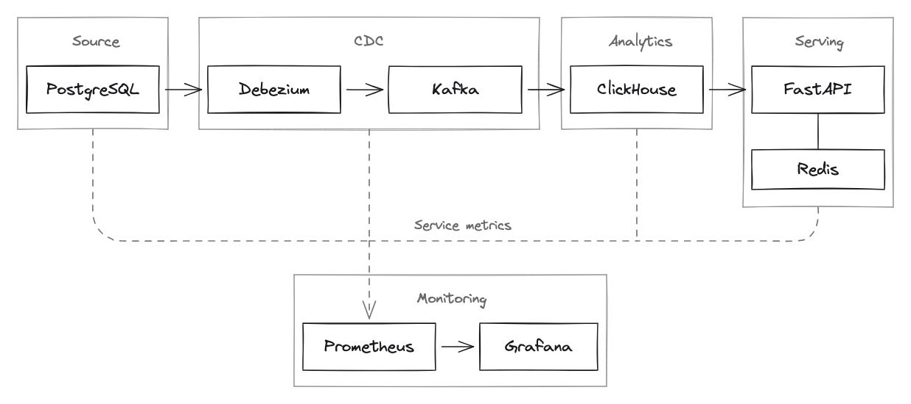
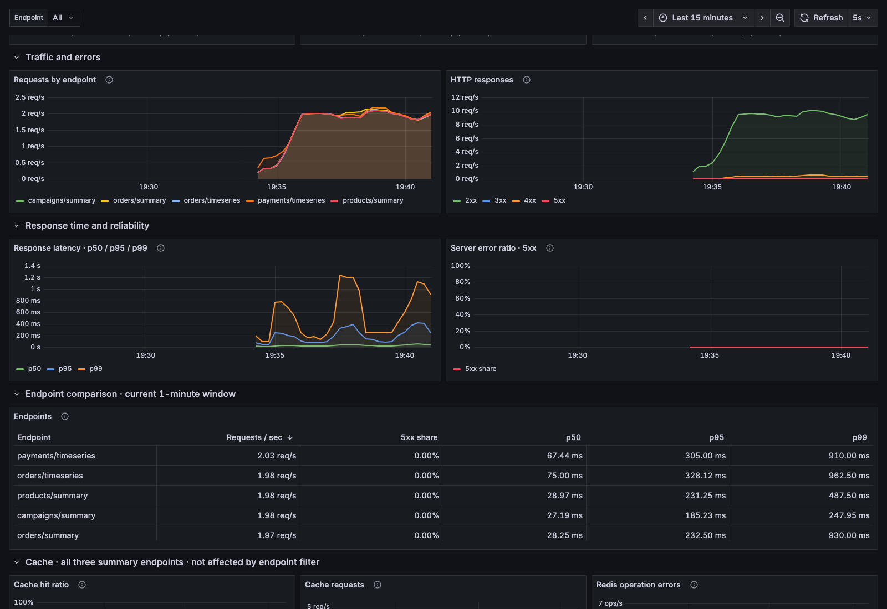
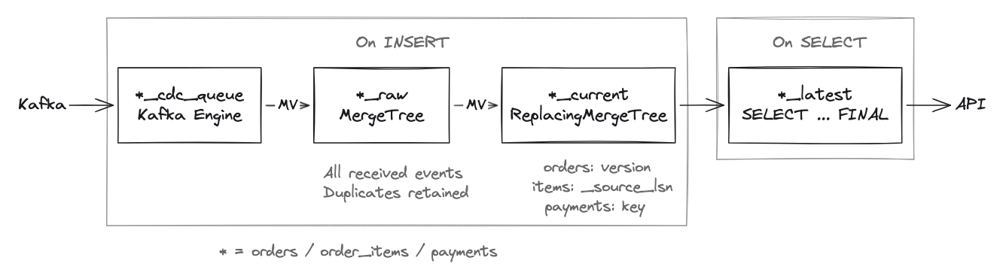

# Realtime-1 Capstone

**English** | [Русский](README.ru.md)

A learning project for streaming order analytics. PostgreSQL stores orders,
line items and payments. Debezium streams changes through Kafka into ClickHouse,
which calculates sales by campaign and product, captures and refunds.
A FastAPI application exposes the results.

The pipeline handles duplicate events, older versions and hard deletes.
Redis caches API responses; Prometheus and Grafana provide monitoring.
The demo changes records in the source and checks the API, then replays
Kafka events to verify that duplicates leave the metrics unchanged.

Built as part of the [NewProLab Realtime Analytics](https://newprolab.com/realtime-analytics) course.
The PostgreSQL schema and data generator are adapted from the course materials.

[Quick start](#quick-start) · [Demo](#demo) · [Runbook](RUNBOOK.md)

Details:

- [Verification results](#verification-results)
- [Data contract](#data-contract)
- [CDC](#cdc)
- [ClickHouse](#clickhouse)
- [API](#api-and-business-metrics)
- [Redis](#redis)
- [Monitoring](#monitoring)
- [Load generators](#load-generators)
- [Project structure](#project-structure)
- [Limitations](#limitations)

## Architecture



[Editable Excalidraw diagram](assets/architecture-excalidraw.excalidraw).

Debezium runs in Kafka Connect. On its first connection, it takes a snapshot
of the PostgreSQL tables, then reads the write-ahead log (WAL) and publishes
changes to Kafka. Each source table has a separate topic.
ClickHouse consumes events through the Kafka engine and processes them with
materialized views (MVs). The API queries ClickHouse views and caches the
three summary responses in Redis for 30 seconds.

Prometheus collects metrics from native service endpoints, JMX agents and
exporters. Grafana uses Prometheus as its data source. Dashed lines show
metrics collection. The data and API load generators are omitted from the diagram.



Part of the API dashboard during a load test. The generator is configured
for 10 requests/s, with 5% invalid requests expected to return `422`.
The charts show request rates by endpoint, HTTP status classes and
p50/p95/p99 response times.

## Quick start

You need Docker with Compose v2, just, uv and Python 3.12 or later.
Docker image versions are specified in `compose.yaml` and the Dockerfile;
Python dependencies are pinned in `uv.lock`. The first run downloads images,
packages from PyPI and a JMX agent from GitHub.

Clone the repository and check for port conflicts.
If you already have a checkout, open its directory and skip `git clone`:

```sh
git clone https://github.com/rmnfl/realtime-1-capstone.git
cd realtime-1-capstone
docker ps --format 'table {{.Names}}\t{{.Status}}\t{{.Ports}}'
lsof -nP -iTCP:55434 -iTCP:19093 -iTCP:28084 -iTCP:18133 -iTCP:18001 -iTCP:19005 -iTCP:13005 -sTCP:LISTEN
```

If a port is in use, copy [.env.example](.env.example) to `.env` and change
the corresponding variable. `just` loads `.env` automatically.
The README examples use the default ports.

```sh
just up
just status
just cdc-status
```

On an empty PostgreSQL volume, the first start runs
[00-init.sql](src/postgres/00-init.sql) and [01-seed.sql](src/postgres/01-seed.sql).
`just up` creates ClickHouse tables and views, registers the Debezium connector,
and starts the API and monitoring services. The connector loads the initial
snapshot, then streams changes from the WAL.

In `just cdc-status`, both the connector and its task should be `RUNNING`.
Once the snapshot has loaded, the API returns metrics for the seed dataset.
See [Initial snapshot](#initial-snapshot) for the check and expected values.

| Service | Host address |
|---|---|
| API: Swagger UI | [localhost:18001/docs](http://localhost:18001/docs) |
| Grafana | [localhost:13005](http://localhost:13005) |
| Prometheus | [localhost:19005](http://localhost:19005) |
| Kafka Connect REST API | [localhost:28084/connectors](http://localhost:28084/connectors) |
| ClickHouse HTTP | `localhost:18133` |
| PostgreSQL | `localhost:55434`, database `capstone` |
| Kafka | `localhost:19093` |

Credentials for the local environment:

| Service and role | Username | Password |
|---|---|---|
| PostgreSQL: administrator | `admin` | `admin` |
| PostgreSQL: CDC reader | `debezium` | `debezium` |
| PostgreSQL: monitoring | `monitor` | `monitor` |
| ClickHouse: administrator | `admin` | `admin` |
| ClickHouse: API and monitoring reader | `reader` | `reader` |
| Grafana | `admin` | `admin` |

Keep `.env` and real secrets out of Git.

```sh
just down              # remove containers and network; preserve volumes and offsets
just start             # start the initialised environment
just down --volumes    # also remove volumes: data, offsets and metrics history
```

PostgreSQL skips its init scripts on an existing volume.
`just clickhouse-setup` creates missing ClickHouse tables and views with
`IF NOT EXISTS`. It does not alter existing objects; apply those DDL changes
separately. The monitoring view `pipeline_metrics` is the exception:
it is updated with `CREATE OR REPLACE VIEW`.

`just down` preserves the PostgreSQL, Kafka and ClickHouse volumes,
including data and CDC offsets. `--volumes` deletes the environment's volumes;
afterwards, use `just up` to initialise everything again.
The Redis cache is lost when its container is removed.

For startup failures or changes that no longer reach the API, follow the
[runbook](RUNBOOK.md).

## Demo

The demo checks the initial load, source changes and deduplication.
Run all commands with the environment running.

### Initial snapshot

The `demo` dataset contains data for 1 January 2026: 12 orders,
14 line items and 9 payment operations. On an empty volume, `01-seed.sql`
inserts them into PostgreSQL before the connector starts.

```sh
just demo-snapshot
```

The command finds raw snapshot events with `op=r` for every source record
and checks responses from all five API endpoints. It prints order counts
by status, the total value of paid orders and payment totals.

| Check | Expected value |
|---|---|
| Orders | 12: 3 `created`, 6 `paid`, 3 `cancelled` |
| Total value of orders with status `paid` | 101000 kopecks |
| Captures | 7 operations totalling 111000 kopecks |
| Refunds | 2 operations totalling 14000 kopecks |
| Captures minus refunds | 97000 kopecks |

Paid order totals and payment totals differ. Order `o8` was cancelled after
a full refund; paid order `o6` has a partial refund of 4000 kopecks.

This checks the load of records that existed before CDC started.
To inspect the full API responses:

```sh
just demo-show demo
```

The check uses fixed expected values. If a generator has already changed
`demo`, it reports the differences without clearing the dataset.
The following steps use a separate dataset, so changes to `demo` do not affect them.

### Source-to-API check

Create an order, pay for it, replay Kafka events and issue a refund.
Run the commands one at a time. Each command explains the action and expected
result, changes the data, waits for the API to reflect it, and compares
responses before and after.

Run commands from the repository root. Choose a new dataset, such as
`show_01`, and use it for all four steps. Choose another name for the next
presentation: the same order cannot be created twice in a used dataset.

#### 1. Create an order

```sh
just demo-create show_01
```

PostgreSQL receives order `o1` for 10000 kopecks and two line items:
one unit of `sku001` at 6000 and two units of `sku002` at 2000 kopecks each.

The API returns one order with status `created`. The paid order amount is zero,
the product summary is empty, and there are no payments.

#### 2. Pay for the order

```sh
just demo-pay show_01
```

One PostgreSQL transaction changes the order to `paid`, sets version 2,
and inserts a capture for 10000 kopecks into `payments`.

The paid order amount in the API rises from 0 to 10000. The product summary
contains two SKUs and three units; the payment results contain one capture.
This checks changes from all three source tables.

#### 3. Replay events

```sh
just demo-duplicates show_01
```

The command locates the original Kafka messages using coordinates stored in
raw and republishes them to the same topics and partitions. Keys and Debezium
envelopes stay unchanged; the duplicates receive new offsets. Messages within
each partition are sent in reverse order, so order version 2 arrives before
version 1. The command does not reset offsets for the active consumer groups.

After the first replay, raw contains 4 order rows instead of 2, 4 line item
rows instead of 2, and 2 payment rows instead of 1. The API should return
the same result: one paid order for 10000 kopecks, three units and one capture.
Running the command again also replays the duplicates already recorded in raw,
so the row counts increase further.

The check verifies that duplicates do not double the totals and that an older
version cannot change the order back to `created`. If Kafka retention has
already removed the original messages, the command fails.

#### 4. Issue a refund

```sh
just demo-refund show_01
```

One transaction changes the order to `cancelled`, sets version 3, and inserts
a refund for 10000 kopecks into `payments`.

The API returns one cancelled order and a paid order amount of zero.
The product summary becomes empty. The capture and refund remain in payment
history, with a net amount of zero.

#### Optional: hard delete

```sh
just demo-delete
```

The command creates an unpaid order with two line items in a new dataset,
checks it through the API, then deletes the line items and order from PostgreSQL.
The API order count should fall from 1 to 0. ClickHouse retains versions
with `is_deleted=1`, which are excluded from business metrics.

A cancelled order remains in the source with status `cancelled`.
A hard delete removes the PostgreSQL row. The order from the main scenario
cannot be deleted: the foreign key in `payments` prevents deletion of orders
with payments.

#### Rehearsal and full responses

Both commands run a complete scenario without pauses between steps:

```sh
just demo             # snapshot, order lifecycle and a separate hard-delete scenario
just demo-pipeline    # order lifecycle only, without checking the seed demo dataset
```

The automated run uses new datasets. Run it before a presentation,
then present steps 1 to 4 individually with another dataset name.

After any step, print JSON responses from all five endpoints:

```sh
just demo-show show_01
```

Requests cover `2026-01-01T00:00:00Z` to `2026-01-02T00:00:00Z`.
You can repeat them in [Swagger UI](http://localhost:18001/docs) with the demo
dataset. Set `refresh=true` on summaries to bypass cache reads.

The checks are in [src/demo/run.py](src/demo/run.py). After each action,
the script compares every field in the five responses, both 24-hour time
series and the payment total with `interval=total`. Summary requests use
`refresh=true`. On a mismatch, the script retries for up to 60 seconds,
then exits with an error and prints the differences.
The commands neither delete volumes nor reset offsets.

## Verification results

Checks were run on 11 November 2026.

| Check | Result |
|---|---|
| Kafka event replay | Raw row counts increase; all five endpoint responses stay unchanged |
| Older order version delivered after a newer one | The order keeps the status and amount from the newer version |
| Redis failure | The API queries ClickHouse directly; caching resumes after Redis starts |
| PostgreSQL, Kafka, Connect, ClickHouse, API and Redis stopped one at a time | After recovery, all five endpoint responses matched expected values derived from PostgreSQL |
| Full restart with `just down` / `just start` | Data and offsets were preserved; no new snapshot was taken |
| Nine alert rules | Every alert fired for the corresponding failure and cleared after recovery |

In the Kafka failure test, processing did not resume within 45 seconds of
restarting the broker, although the Connect task stayed `RUNNING`.
After `just connect-restart`, changes reached the API.
See the [runbook](RUNBOOK.md#after-recovery) for diagnosis and data reconciliation.

## Design decisions

- PostgreSQL is the source of truth. The generator writes to the database,
  and Debezium reads the WAL. The generator does not need to publish the same
  changes to Kafka separately.
- Raw tables retain every event received. Kafka coordinates identify the
  original message when investigating duplicates or ingestion delays.
- `ReplacingMergeTree` removes superseded versions during background merges.
  Views read current tables with `FINAL` so that duplicates and older versions
  are excluded before merges finish. Orders use `version`; line items use LSN.
  Payments are immutable, so their operation key is sufficient for deduplication.
- Redis caches the three summaries for 30 seconds. When Redis is unavailable,
  the API queries ClickHouse directly. Time series are not cached.
- Service availability and data processing are checked separately. With an
  ingestion MV detached, all services passed health checks, but new orders
  did not reach the API. The consumer lag alert detected the stalled processing.
- Zero lag means the consumer has caught up with Kafka. A source change may
  still be waiting in Debezium. The control scenario therefore starts with
  a PostgreSQL write and ends by checking the API response.

## Data contract

The PostgreSQL database and schema are both named `capstone`.
Identifiers use `TEXT`, timestamps use `TIMESTAMPTZ`, and amounts and prices
use `BIGINT` in whole kopecks. The DDL is in [00-init.sql](src/postgres/00-init.sql).

Every table has a composite primary key `(dataset_id, id)`, so the same `id`
can occur in different datasets. Line items and payments reference orders
through the composite foreign key `(dataset_id, order_id)`.

```text
orders
  dataset_id       TEXT         NOT NULL
  id               TEXT         NOT NULL
  campaign_id      TEXT         NOT NULL
  status           TEXT         NOT NULL
  amount_cents     BIGINT       NOT NULL
  version          INTEGER      NOT NULL
  created_at       TIMESTAMPTZ  NOT NULL
  updated_at       TIMESTAMPTZ  NOT NULL
  PRIMARY KEY (dataset_id, id)
```

```text
order_items
  dataset_id       TEXT         NOT NULL
  id               TEXT         NOT NULL
  order_id         TEXT         NOT NULL
  sku              TEXT         NOT NULL
  quantity         INTEGER      NOT NULL
  unit_price_cents BIGINT       NOT NULL
  PRIMARY KEY (dataset_id, id)
  FK (dataset_id, order_id) -> orders(dataset_id, id)
```

```text
payments
  dataset_id       TEXT         NOT NULL
  id               TEXT         NOT NULL
  order_id         TEXT         NOT NULL
  kind             TEXT         NOT NULL
  amount_cents     BIGINT       NOT NULL
  occurred_at      TIMESTAMPTZ  NOT NULL
  PRIMARY KEY (dataset_id, id)
  FK (dataset_id, order_id) -> orders(dataset_id, id)
```

Orders have three statuses: `created`, `paid` and `cancelled`.
`amount_cents` stores the order amount. `created_at` is the creation timestamp;
`updated_at` is the last modification timestamp. On UPDATE, the application
must increment `version` and update `updated_at`. PostgreSQL has no trigger
for this.

For line items, `quantity` is the number of units and `unit_price_cents` is
the price per unit. In the seed dataset and generator, an order amount equals
the sum of `quantity * unit_price_cents` across its line items.

`payments` is an append-only log. Each row represents a `capture` or `refund`,
with its timestamp in `occurred_at`. An order can have multiple operations.
Existing payments are never updated or deleted; the ClickHouse pipeline
does not handle UPDATE or DELETE for this table.

Updating an order status and inserting a payment are separate SQL statements.
The control scenario executes them in one PostgreSQL transaction.

## CDC

The Debezium connector settings are in [connector.json](src/debezium/connector.json).
The snapshot and subsequent changes for each table go to a separate topic:

- `capstone.capstone.orders`;
- `capstone.capstone.order_items`;
- `capstone.capstone.payments`.

Kafka message keys contain `dataset_id` and `id` as JSON.
Values keep the original Debezium envelope: `op`, `before`, `after`,
`source` and timestamps.

| Operation | `op` | `before` | `after` |
|---|---|---|---|
| Snapshot | `r` | `null` | Row from the snapshot |
| INSERT | `c` | `null` | New row |
| UPDATE | `u` | Previous row | New row |
| DELETE | `d` | Previous row | `null` |

After DELETE, the connector sends a tombstone with the same key and `value=null`.
Kafka preserves message order within a partition. There is no global ordering
across partitions or topics.

## ClickHouse



[Editable Excalidraw diagram](assets/clickhouse-excalidraw.excalidraw).

MVs process new inserts. The `*_latest` views run at SELECT time.
Each of `orders`, `order_items` and `payments` has its own chain of tables
and views.

The Kafka engine reads topics through `*_cdc_queue` tables.
The `*_cdc_to_raw` materialized views parse JSON and insert events into
`orders_raw`, `order_items_raw` and `payments_raw`.
Every duplicate received adds another raw row.

The `*_raw_to_current` MVs then insert rows into `*_current` tables using
`ReplacingMergeTree`. Rows with the same sorting key `(dataset_id, id)`
are replaced according to these rules:

| Table | Replacement rule |
|---|---|
| `orders_current` | Keep the row with the highest `version` |
| `order_items_current` | Keep the row with the highest `_source_lsn` |
| `payments_current` | Keep one row per key; duplicate payments must have identical business fields |

For example, an order has moved from `created` at version 1 to `paid` at
version 2. A replay of version 1 must not change its status.

Background merges in ReplacingMergeTree remove superseded row versions.
The `orders_latest`, `order_items_latest` and `payments_latest` views read
current tables with `FINAL` to get the same result before merges finish.
The business views query these latest views.

For DELETE, ClickHouse receives a version marked as deleted.
For an order, the MV takes fields from `before`, sets `is_deleted=1`
and increments `before.version` by one. For a line item, it uses the previous
fields, a deletion flag and the event's LSN. PostgreSQL has no `is_deleted`
column. The views select the latest version first, then exclude deleted rows.

Tombstones are not inserted into raw: `op=d` already carries the deletion.
Payments accept only snapshot and INSERT events (`op=r` and `op=c`).

Raw tables retain event metadata:

| Field | Contents |
|---|---|
| `_source_lsn` | `source.lsn`: the change's position in the WAL |
| `_source_ts` | `source.ts_ms`: the PostgreSQL change timestamp for CDC events |
| `_debezium_ts` | Top-level `ts_ms`: when Debezium processed the event |
| `_ingested_at` | When the ClickHouse MV processed the row |
| `_operation` | The `op` value: r / c / u / d |
| `_kafka_topic`, `_kafka_partition`, `_kafka_offset` | Message topic, partition and offset |

Kafka coordinates identify the message; timestamps help estimate latency
between pipeline stages. If the envelope lacks `source.ts_ms` or top-level
`ts_ms`, the corresponding raw timestamp is `NULL`.
Only `_source_lsn` is copied to current tables.

## API and business metrics

The API has five GET endpoints under
`http://localhost:18001/v1/datasets/{dataset_id}/metrics/`.
For example, the order summary for `demo` is at
`/v1/datasets/demo/metrics/orders/summary`.

FastAPI generates an OpenAPI schema from routes and parameter models.
[Swagger UI](http://localhost:18001/docs) uses this schema to display parameters
and let you send requests from a browser.

Every request requires `from` and `to` as ISO 8601 timestamps with a timezone,
such as `2026-01-01T00:00:00Z`. The API normalises timestamps to UTC.
The time range includes its start and excludes its end.
The start must precede the end; the maximum range is 31 days.
`dataset_id` must match `[a-z0-9][a-z0-9_-]{0,63}`.

In a successful response, `data` contains the result and `meta.computed_at`
is the calculation timestamp. `orders/summary` returns a summary object;
the other endpoints return arrays of records. Amounts are in kopecks;
the average paid order amount can be fractional.
All calculations use the latest record versions loaded into ClickHouse.

### Example request

The seed dataset `demo` for 1 January 2026:

```sh
curl -fsS --get 'http://localhost:18001/v1/datasets/demo/metrics/orders/summary' \
  --data-urlencode 'from=2026-01-01T00:00:00Z' \
  --data-urlencode 'to=2026-01-02T00:00:00Z' \
  --data-urlencode 'refresh=true' \
  | python3 -m json.tool
```

Response from the running environment:

```json
{
  "data": {
    "orders_count": 12,
    "created_orders_count": 3,
    "paid_orders_count": 6,
    "cancelled_orders_count": 3,
    "paid_amount_cents": 101000,
    "avg_paid_amount_cents": 16833.333333333332,
    "paid_share": 0.5,
    "cancelled_share": 0.25
  },
  "meta": {
    "computed_at": "2026-11-11T22:28:33.481485Z"
  }
}
```

A repeated request changes `meta.computed_at`. If CDC has processed all
changes and the dataset has not changed since, the other values stay the same.

### Orders: `orders/summary`

A summary of orders created within the selected period (`orders.created_at`).
Deleted orders are excluded. `campaign_id` filters to one campaign;
`refresh=true` bypasses cache reads.

| Field | Meaning |
|---|---|
| `orders_count` | Total number of orders in the selection |
| `created_orders_count` | Orders with status `created` |
| `paid_orders_count` | Orders with status `paid` |
| `cancelled_orders_count` | Orders with status `cancelled` |
| `paid_amount_cents` | Sum of `amount_cents` for orders with status `paid` |
| `avg_paid_amount_cents` | `paid_amount_cents / paid_orders_count`; `null` when there are no paid orders |
| `paid_share` | `paid_orders_count / orders_count`; from 0 to 1, or `null` when there are no orders |
| `cancelled_share` | `cancelled_orders_count / orders_count`; from 0 to 1, or `null` when there are no orders |

With no orders, counts and amounts are 0; the average and shares are `null`.

### Campaigns: `campaigns/summary`

The same statistics grouped by campaign. The selection includes orders
created within the period and excludes deleted orders.
Supported parameters are `limit` and `refresh`.

| Field | Meaning |
|---|---|
| `campaign_id` | Campaign identifier |
| `orders_count` | Orders in this campaign |
| `created_orders_count` | Campaign orders with status `created` |
| `paid_orders_count` | Campaign orders with status `paid` |
| `cancelled_orders_count` | Campaign orders with status `cancelled` |
| `paid_amount_cents` | Total amount of campaign orders with status `paid` |
| `avg_paid_amount_cents` | `paid_amount_cents / paid_orders_count`; `null` when there are no paid orders |
| `paid_share` | `paid_orders_count / orders_count` for this campaign |
| `cancelled_share` | `cancelled_orders_count / orders_count` for this campaign |

Results are sorted by `paid_amount_cents` descending, then `campaign_id`
ascending. `limit`, from 1 to 100, caps the number of campaigns.
Without it, the API returns all campaigns. An empty selection returns `[]`.

The two summaries use [one view](src/clickhouse/metrics/01-campaign-summary.sql).
For `orders/summary`, the API aggregates campaign counts and amounts,
then calculates the average paid order amount and shares.

### Products: `products/summary`

Sales by SKU from paid orders. The period filters the order creation timestamp.
Deleted orders and line items are excluded.
Supported parameters are `campaign_id`, `limit` and `refresh`.

| Field | Meaning |
|---|---|
| `sku` | Product identifier |
| `paid_orders_count` | Distinct orders with status `paid` containing this SKU |
| `units_count` | Sum of `quantity` for this SKU's line items |
| `items_amount_cents` | Sum of `quantity * unit_price_cents` for this SKU's line items |

Results are sorted by `items_amount_cents` descending, then SKU ascending.
`limit`, from 1 to 100, caps the number of products. Without it, the API
returns all products. An empty selection returns `[]`.

### Hourly orders: `orders/timeseries`

Hourly statistics by order creation time, using the latest loaded status.
Deleted orders are excluded. `campaign_id` filters to one campaign.

| Field | Meaning |
|---|---|
| `bucket_start` | Start of the hour in UTC |
| `orders_count` | Orders created in this hour |
| `created_orders_count` | Orders from this hour with status `created` |
| `paid_orders_count` | Orders from this hour with status `paid` |
| `cancelled_orders_count` | Orders from this hour with status `cancelled` |
| `paid_amount_cents` | Total amount of orders from this hour with status `paid` |
| `avg_paid_amount_cents` | Hourly `paid_amount_cents / paid_orders_count`; `null` when there are no paid orders |
| `cumulative_paid_amount_cents` | Sum of `paid_amount_cents` from the start of the selected period through this hour |

Rows are sorted chronologically. Hours with no orders have zero counts and
amounts, a `null` average, and an unchanged cumulative amount.
When an order is paid, its amount appears in its creation hour, not its payment hour.

The `from` and `to` filters apply before grouping.
If the period starts at 12:30 UTC, the first bucket is labelled 12:00 UTC,
but includes only orders from 12:30 onwards. Payments follow the same rule.

### Payments: `payments/timeseries`

Operation counts and amounts by `payments.occurred_at`.
`interval=hour` returns an hourly series; `interval=total` returns the period
total. The default is `hour`.

| Field | Meaning |
|---|---|
| `bucket_start` | Start of the hour in UTC; for `interval=total`, the `from` value normalised to UTC |
| `captures_count` | Number of `capture` operations |
| `captured_amount_cents` | Total amount of `capture` operations |
| `refunds_count` | Number of `refund` operations |
| `refunded_amount_cents` | Total amount of `refund` operations |
| `net_amount_cents` | `captured_amount_cents - refunded_amount_cents` |

Hourly rows are sorted chronologically, with missing hours filled with zeros.
With `total`, the API always returns an array with one record, even when
there are no payments. Cancelling an order leaves payment history unchanged:
a refund enters the calculation after a `refund` operation is inserted into `payments`.

### Errors

| Code | Cause |
|---|---|
| `422` | Invalid parameters, such as missing `from`, a malformed date, an unknown parameter or a period longer than 31 days |
| `429` | The request waited more than 0.5 s for a ClickHouse query slot; at most 4 queries run concurrently |
| `503` | A ClickHouse connection error, SQL error, response parsing error or query timeout of 5 s |

Operational routes have no `/v1/datasets/...` prefix.
`/ping` checks the API process without calling databases;
`/metrics` exposes Prometheus metrics.

## Redis

The cache stores responses for `orders/summary`, `campaigns/summary` and
`products/summary`. The key includes the endpoint, dataset, period and filters.
On a cache hit, the API returns the stored response. On a miss, it queries
ClickHouse and writes the result to Redis.

The TTL is 30 seconds from the write; reads do not extend it.
`refresh=true` skips the cache read, runs the query and updates the same entry.
The next request with the same parameters can use the new result.

On Redis errors, the API queries ClickHouse directly. A failed cache write
does not prevent it from returning the calculated result. Errors are logged
and counted in `capstone_redis_errors_total`. A malformed cache entry counts
as a miss and is replaced with a new result.
`orders/timeseries` and `payments/timeseries` are not cached.

In a cached response, `meta.computed_at` keeps the original calculation time.
It does not measure data freshness: when CDC is behind, even `refresh=true`
returns stale values with a new calculation timestamp.

## Monitoring

Prometheus collects metrics from PostgreSQL, Kafka, Connect, ClickHouse,
the API and Redis. It uses native metrics endpoints where available, and
JMX agents or exporters for the other services. Grafana displays the metrics.

### Metrics collection

| Service | Metrics source | Main metrics |
|---|---|---|
| PostgreSQL | `postgres-exporter` connects as `monitor` | Database availability, connections, transactions, WAL and replication slots |
| Kafka | A broker JMX agent and a separate `kafka-exporter` | Broker and partition state, message throughput, offsets and consumer lag |
| Kafka Connect / Debezium | A JMX agent in the Connect process | Connector and task state, source connection, event queue, snapshot and errors |
| ClickHouse | Native metrics endpoint and a SQL query against `pipeline_metrics` | Memory usage, queries, merges, Kafka consumption and ingestion latency |
| API | `/metrics`, using `prometheus-client` | Request counts and HTTP status codes, request duration, cache hits and Redis errors |
| Redis | `redis-exporter` connects to Redis | Availability, memory, clients, commands, key expiry and eviction |

[prometheus.yml](monitoring/prometheus.yml) defines eight scrape jobs.
API metrics are scraped every 2 seconds; the others every 10 seconds.
Scrape errors appear on the [Targets](http://localhost:19005/targets) page.
A target status of `UP` means Prometheus received metrics.
PostgreSQL and Redis availability are checked separately through `pg_up`
and `redis_up`. Prometheus and Grafana's own metrics are not collected.

### Grafana

The Prometheus data source and dashboards are provisioned automatically
when [Grafana](http://localhost:13005) starts. No manual UI setup is required.

### Alerts

Rules are in [alerts.yml](monitoring/alerts.yml). An alert enters `Firing`
when its condition has held continuously for the duration specified by `for`.

| Alert | Condition | `for` |
|---|---|---|
| `ApiUnavailable` | Prometheus cannot scrape the API's `/metrics` endpoint | 10 s |
| `ApiErrors` | More than 50% of responses from one business endpoint are 5xx, measured over the last 30 s | 10 s |
| `RedisErrors` | The API recorded Redis errors in the last 30 s | 10 s |
| `PostgresUnavailable` | postgres-exporter cannot connect to PostgreSQL | 10 s |
| `RedisUnavailable` | redis-exporter cannot connect to Redis | 10 s |
| `CdcTaskNotRunning` | Task 0 of `capstone-cdc` is not `RUNNING`, or its state metric is absent | 30 s |
| `PipelineMetricsUnavailable` | Metrics cannot be collected from PostgreSQL, Kafka, Connect, ClickHouse or Redis, including consumer lag and ingestion latency metrics | 30 s |
| `PipelineMetricsCollectionFailed` | The PostgreSQL exporter or Kafka/Connect JMX agent reports a metrics collection error | 30 s |
| `ClickHouseConsumerLag` | The ClickHouse group's total consumer lag for one CDC topic is greater than zero | 30 s |

Alert states are available on [Prometheus Alerts](http://localhost:19005/alerts).
Notification delivery is not configured.

## Load generators

Both generators are in [src/generator](src/generator).
Their dependencies belong to the `generator` group and are pinned in the
shared `uv.lock`. Progress and the final report go to stderr; dry-run output
goes to stdout as JSONL. Arguments after a just recipe name override its
defaults. See `just data-load --help` and `just api-load --help` for options.

| Command | just defaults |
|---|---|
| `just data-load` | Up to 300 s or 10000 orders; 1000 row changes/s, batches of 500; a new dataset_id |
| `just api-load` | Up to 300 s; 10 requests/s, up to 4 concurrent; `demo`, 1 January; 5% invalid requests |

`data-load` stops at whichever limit it reaches first: 300 seconds or
10000 orders. At 1000 row changes/s, a run may finish before five minutes.

To load the source and API together, run the commands in two terminals with
the same dataset. Replace `load_01` with a new name for the next run:

```sh
# Terminal 1: orders for 1 January; refunds may fall on 2 January.
just data-load --dataset load_01 --rate 100 --batch-size 100 --days 1

# Terminal 2: the same dataset, with a range covering next-day refunds.
just api-load --dataset load_01 --from 2026-01-01T00:00:00Z --to 2026-01-03T00:00:00Z
```

The data generator creates orders with line items, captures, full refunds
with order cancellation, and hard deletes of unpaid orders.
`--paid-rate`, `--refund-rate` and `--delete-rate` set the probabilities.
`--rate` limits row changes per second, not orders; 0 disables the limit.
The generator prints expected totals at the end.

To add orders to an existing `demo` dataset, set `--start-id` above every
previously used number, including deleted ones. Reusing an existing ID causes
a primary key conflict; deleted IDs must not be reused either.

In Kafka mode, the generator sends Debezium-compatible events with `before`,
`after`, `op` and `source` directly to `capstone.capstone.*` topics.
This bypasses PostgreSQL and Connect, so it can test ClickHouse ingestion
and deduplication separately with `--duplicate-rate`.
`source.lsn` is a synthetic increasing sequence, and `source.ts_ms` is the
event generation time. These timestamps do not measure CDC latency.
Use a new dataset: synthetic LSNs and real PostgreSQL WAL positions must
not be mixed for the same keys.

```sh
uv run --locked --group generator src/generator/data_load.py kafka \
  --dataset kafka_01 --orders 100 --days 1 --duplicate-rate 0.2
```

In the API load generator, `--error-rate` sets the fraction of requests
expected to return `422`. Repeat `--error-type` to select `missing-from`,
`invalid-date`, `reversed-period` or `invalid-dataset` errors.
`--seed` makes the sequence reproducible; `--endpoint` selects one or more
routes. `--refresh-rate` sets the fraction of summary requests that bypass
cache reads; the default is 20%.

```sh
just data-load --orders 3 --dry-run
just api-load --dry-run --requests 10 --error-rate 0.5
just api-load --requests 100 --error-rate 0.25 --seed 42
just api-load --endpoint orders/summary --refresh-rate 1 --error-rate 0
```

The generator sends batches of API requests with pauses to maintain the
requested average rate. When the API slows down, actual RPS falls without
building a request queue. Once the duration expires, the generator waits
for in-flight requests; each has a 10-second timeout.

The report includes HTTP status codes, expected and unexpected responses,
network errors, and p50/p95/p99 response times by endpoint. Percentiles are
measured on the client and include error responses. The generator does not
validate business metric values. The API returns `422` for invalid parameters,
`429` on overload and `503` for ClickHouse errors.
`ApiErrors` responds to 5xx; intentional `422` responses do not trigger it.

## Project structure

```text
realtime-1-capstone/
├── README.md / README.ru.md    # project documentation in English and Russian
├── RUNBOOK.md / RUNBOOK.ru.md  # troubleshooting and recovery in both languages
├── compose.yaml          # containers and data volumes
├── justfile              # startup, diagnostics and load generation
├── Dockerfile            # API image
├── pyproject.toml        # dependencies; versions pinned in uv.lock
├── .env.example          # port settings
├── assets/               # Excalidraw diagrams and a Grafana screenshot
├── src/
│   ├── postgres/         # tables, roles and seed data
│   ├── debezium/         # CDC configuration
│   ├── clickhouse/
│   │   ├── setup/        # raw, current, latest and MVs
│   │   └── metrics/      # business views
│   ├── api/              # FastAPI, SQL queries, cache and metrics
│   ├── generator/        # data and API load generators
│   └── demo/             # snapshot, CDC and Kafka replay scenarios
└── monitoring/
    ├── prometheus.yml    # metrics collection
    ├── alerts.yml        # alert rules
    ├── postgres/         # postgres-exporter settings
    ├── jmx/              # Kafka and Connect metrics
    ├── clickhouse/       # ClickHouse and ingestion latency metrics
    └── grafana/          # dashboards and provisioning
```

`src/` contains SQL scripts, Debezium settings, the API and load generators.
`monitoring/` contains Prometheus, exporter and Grafana configuration,
alert rules and dashboard JSON files. `compose.yaml` defines services,
the network and volumes; `justfile` contains startup and maintenance commands.
English documentation is in `README.md` and `RUNBOOK.md`; Russian versions
are in `README.ru.md` and `RUNBOOK.ru.md`.

## Limitations

- Each service runs as a single instance. There is no replication or automatic failover.
- Changes to the three tables are processed independently. Even after one PostgreSQL transaction, the API may temporarily show only some changes: an order is paid, but its payment has not loaded yet.
- `payments` supports an append-only log. Refunds are separate operations; ClickHouse does not process payment UPDATE or DELETE events. A hard-deleted order's key must not be reused.
- Line item versions use LSN. Multiple changes to the same line item in one transaction have not been tested separately.
- The API reads data already loaded into ClickHouse. When CDC stops, it keeps returning the previous values. `refresh=true` bypasses the cache without waiting for new events; a 30-second TTL does not guarantee freshness.
- In the tested ClickHouse 25.8, the last tombstone may remain uncommitted until another message arrives. Consumer lag is then 1 even though DELETE has been processed. The runbook explains how to distinguish this case from a processing delay.
- Raw tables have no TTL, so event history grows without automatic cleanup. Ingestion latency monitoring queries read these same tables.
- Credentials are intended for a local learning environment. Alerts are available in Prometheus and Grafana without notification delivery. Prometheus and Grafana's own metrics are not collected.
