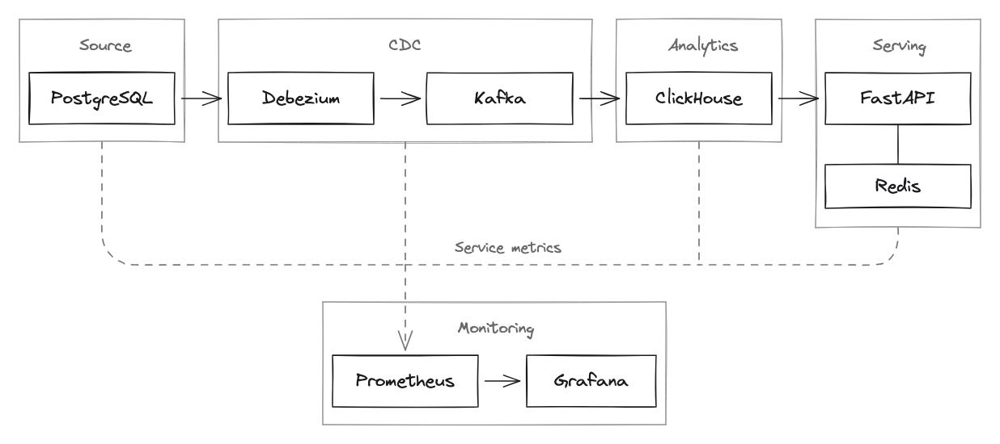
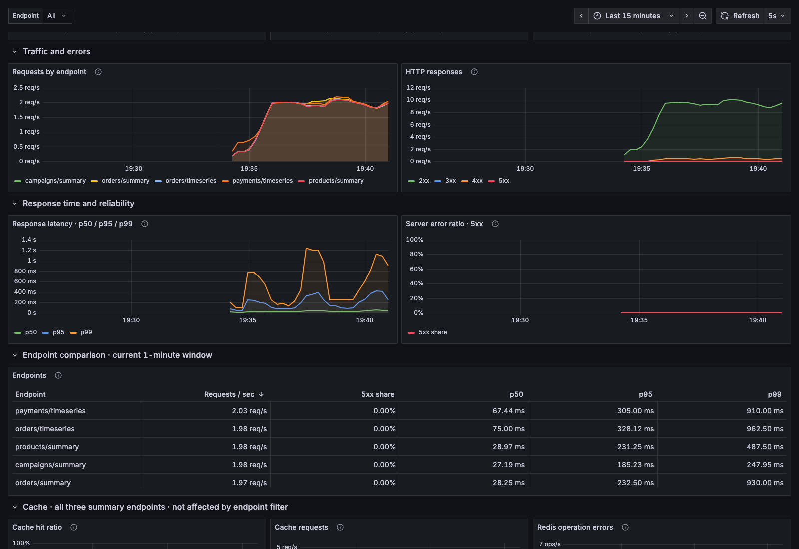
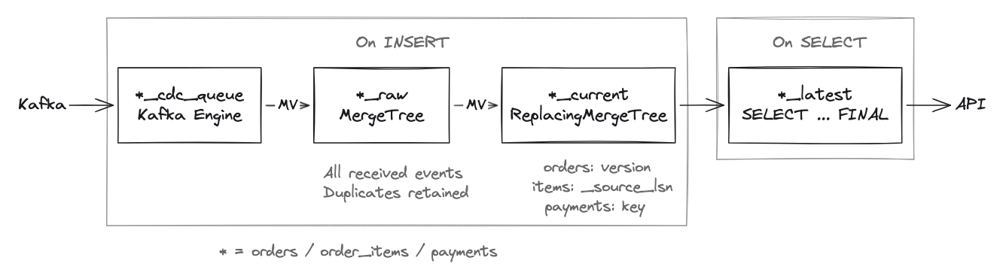

# NPL Realtime-1 Capstone

[English](README.md) | **Русский**

Учебный проект по потоковой аналитике заказов. PostgreSQL хранит заказы,
позиции и платежи. Debezium передаёт изменения через Kafka в ClickHouse,
где рассчитываются продажи по кампаниям и товарам, оплаты и возвраты.
Результаты доступны через API на FastAPI.

В проекте есть дедупликация событий, обработка старых версий и физических
удалений, кэш Redis и мониторинг в Prometheus и Grafana. В демо можно изменить
данные в источнике и проверить результат в API, затем повторно отправить
события в Kafka и убедиться, что метрики не изменились.

Проект выполнен в рамках курса [NewProLab Realtime Analytics](https://newprolab.com/realtime-analytics).
Схема PostgreSQL и генератор данных адаптированы из материалов курса.

[Быстрый старт](#быстрый-старт) · [Демо](#демо) · [Ранбук](RUNBOOK.ru.md)

Подробности:

- [Результаты проверок](#результаты-проверок)
- [Контракт данных](#контракт-данных)
- [CDC](#cdc)
- [ClickHouse](#clickhouse)
- [API](#api-и-бизнес-метрики)
- [Redis](#redis)
- [Мониторинг](#мониторинг)
- [Генераторы](#генераторы)
- [Структура проекта](#структура-проекта)
- [Ограничения](#ограничения)

## Архитектура



[Редактируемая схема Excalidraw](assets/architecture-excalidraw.excalidraw).

Debezium запущен в Kafka Connect. При первом подключении он делает snapshot
таблиц PostgreSQL, затем читает WAL и публикует изменения в Kafka.
Для каждой исходной таблицы используется отдельный топик.
ClickHouse читает события через Kafka Engine и обрабатывает их в materialized views (MV).
API делает запросы к витринам ClickHouse и кэширует три сводки в Redis на 30 секунд.

Prometheus собирает метрики через встроенные эндпоинты сервисов, JMX-агенты
и экспортеры. Grafana использует Prometheus как источник данных.
Пунктиром показан сбор метрик. Генераторы данных и нагрузки на API на схеме не показаны.



Фрагмент дашборда API во время нагрузочного прогона. Генератор настроен
на 10 запросов/с и 5% некорректных запросов с ожидаемым кодом `422`.
На графиках видны частота запросов по эндпоинтам, классы HTTP-кодов
и p50/p95/p99 времени ответа.

## Быстрый старт

Для запуска нужны Docker с Compose v2, just, uv и Python 3.12 или новее.
Версии Docker-образов указаны в `compose.yaml` и Dockerfile,
а Python-зависимости зафиксированы в `uv.lock`. При первом запуске скачиваются образы,
пакеты из PyPI и JMX-агент с GitHub.

Склонируйте репозиторий и проверьте, свободны ли порты стенда.
Если репозиторий уже скачан, перейдите в его каталог и пропустите `git clone`:

```sh
git clone https://github.com/rmnfl/npl-realtime1-capstone.git
cd npl-realtime1-capstone
docker ps --format 'table {{.Names}}\t{{.Status}}\t{{.Ports}}'
lsof -nP -iTCP:55434 -iTCP:19093 -iTCP:28084 -iTCP:18133 -iTCP:18001 -iTCP:19005 -iTCP:13005 -sTCP:LISTEN
```

Если порт занят, скопируйте [.env.example](.env.example) в `.env` и измените
соответствующую переменную. `just` автоматически загружает `.env`.
В примерах README используются порты по умолчанию.

```sh
just up
just status
just cdc-status
```

При первом запуске на пустом volume PostgreSQL выполняет
[00-init.sql](src/postgres/00-init.sql) и [01-seed.sql](src/postgres/01-seed.sql).
Команда `just up` создаёт таблицы и витрины ClickHouse, регистрирует коннектор
Debezium, запускает API и мониторинг. Коннектор загружает snapshot,
после чего начинает передавать изменения из WAL.

В выводе `just cdc-status` у коннектора и его задачи должен быть статус `RUNNING`.
После загрузки snapshot API вернёт метрики начального датасета.
Проверка и ожидаемые значения приведены в разделе «Исходный snapshot».

| Сервис | Адрес с хоста |
|---|---|
| API: Swagger UI | [localhost:18001/docs](http://localhost:18001/docs) |
| Grafana | [localhost:13005](http://localhost:13005) |
| Prometheus | [localhost:19005](http://localhost:19005) |
| Kafka Connect REST API | [localhost:28084/connectors](http://localhost:28084/connectors) |
| ClickHouse HTTP | `localhost:18133` |
| PostgreSQL | `localhost:55434`, база `capstone` |
| Kafka | `localhost:19093` |

Учётные записи для локального стенда:

| Сервис и назначение | Пользователь | Пароль |
|---|---|---|
| PostgreSQL: администратор стенда | `admin` | `admin` |
| PostgreSQL: чтение CDC | `debezium` | `debezium` |
| PostgreSQL: мониторинг | `monitor` | `monitor` |
| ClickHouse: администратор | `admin` | `admin` |
| ClickHouse: чтение из API и мониторинга | `reader` | `reader` |
| Grafana | `admin` | `admin` |

Файл `.env` и реальные секреты в Git не добавляются.

```sh
just down              # удалить контейнеры и сеть, сохранить volumes и offsets
just start             # запустить уже подготовленный стенд
just down --volumes    # удалить также volumes: данные, offsets и историю метрик
```

На существующем volume PostgreSQL пропускает init-скрипты.
Команда `just clickhouse-setup` создаёт отсутствующие таблицы и витрины ClickHouse
через `IF NOT EXISTS`. Она не применяет изменения к существующим объектам:
для этого нужно отдельно выполнить DDL. Исключение составляет представление
мониторинга `pipeline_metrics`, которое обновляется через `CREATE OR REPLACE VIEW`.

`just down` сохраняет volumes PostgreSQL, Kafka и ClickHouse вместе с данными
и позициями чтения CDC. Флаг `--volumes` удаляет volumes стенда;
после этого запускайте проект с нуля через `just up`.
Кэш Redis при удалении контейнера теряется.

Если стенд не запускается или изменения перестали доходить до API,
порядок диагностики описан в [ранбуке](RUNBOOK.ru.md).

## Демо

Демо проверяет начальную загрузку, изменения в источнике и дедупликацию.
Все команды выполняются на запущенном стенде.

### Исходный snapshot

В датасете `demo` лежат данные за 1 января 2026 года: 12 заказов,
14 позиций и 9 платёжных операций. Скрипт `01-seed.sql` добавляет их
в PostgreSQL на пустом volume, до запуска коннектора.

```sh
just demo-snapshot
```

Команда находит в raw snapshot-события с `op=r` для всех исходных записей
и сверяет ответы пяти эндпоинтов API. Команда выведет число заказов
по статусам, сумму оплаченных заказов и суммы платежей.

| Что показываем | Ожидаемое значение |
|---|---|
| Заказы | 12: 3 `created`, 6 `paid`, 3 `cancelled` |
| Сумма заказов со статусом `paid` | 101000 копеек |
| Оплаты | 7 операций на 111000 копеек |
| Возвраты | 2 операции на 14000 копеек |
| Оплаты минус возвраты | 97000 копеек |

Суммы оплаченных заказов и платежей различаются. Заказ `o8` отменён
после полного возврата, а у оплаченного заказа `o6` есть частичный возврат
на 4000 копеек.

Так проверяется загрузка данных, которые уже были в источнике до запуска CDC.
Полные ответы API можно посмотреть отдельно:

```sh
just demo-show demo
```

Проверка использует фиксированные ожидаемые значения. Если в `demo` уже работал
генератор, команда покажет расхождения. Она не очищает датасет.
Для следующих шагов используется другой датасет, поэтому изменения в `demo`
им не мешают.

### Контрольный сценарий: из PostgreSQL в API

В четырёх шагах создадим заказ, оплатим его, повторим события Kafka
и оформим возврат. Выполняйте команды по одной: каждая показывает действие
и ожидаемый результат, вносит изменения, ждёт их появления в API
и выводит сравнение до и после.

Запускайте команды из корня репозитория. Выберите новый датасет,
например `show_01`, и указывайте его во всех четырёх шагах.
Для следующего показа возьмите другое имя: повторно создать заказ
в использованном датасете нельзя.

#### 1. Создаём заказ

```sh
just demo-create show_01
```

В PostgreSQL появятся заказ `o1` на 10000 копеек и две позиции:
одна единица `sku001` по 6000 и две единицы `sku002` по 2000 копеек.

API вернёт один заказ в статусе `created`. Сумма оплаченных заказов равна нулю,
товарная сводка пуста, платежей нет.

#### 2. Оплачиваем заказ

```sh
just demo-pay show_01
```

В одной транзакции PostgreSQL заказ переходит в статус `paid` с версией 2,
а в `payments` добавляется оплата на 10000 копеек.

В API сумма оплаченных заказов вырастет с 0 до 10000.
В товарной сводке появятся два SKU и три единицы товара,
в платежах одна оплата. Здесь проверяются изменения всех трёх таблиц источника.

#### 3. Повторно доставляем события

```sh
just demo-duplicates show_01
```

Команда находит исходные сообщения Kafka по координатам из raw и заново
публикует их в те же топики и партиции. Ключи и Debezium envelope сохраняются,
повторы получают новые offsets. Внутри каждой партиции сообщения отправляются
в обратном порядке: версия заказа 2 раньше версии 1.
Команда не сбрасывает offsets рабочих consumer groups.

При первом повторе в raw будет 4 строки заказов вместо 2, 4 строки позиций
вместо 2 и 2 строки платежей вместо 1. API должен вернуть прежний результат:
один оплаченный заказ на 10000 копеек, три единицы товара и одну оплату.
Следующий запуск повторит и уже добавленные raw-события, поэтому строк станет больше.

Проверка подтверждает, что дубли не удваивают суммы, а старая версия
не возвращает заказ в статус `created`. Если исходные сообщения уже удалены
из Kafka по retention, команда завершится с ошибкой.

#### 4. Возвращаем деньги

```sh
just demo-refund show_01
```

В одной транзакции заказ переходит в статус `cancelled` с версией 3,
а в `payments` добавляется возврат на 10000 копеек.

API вернёт один отменённый заказ и нулевую сумму оплаченных заказов.
Товарная сводка станет пустой. Оплата и возврат останутся в истории платежей,
их разница будет равна нулю.

#### Дополнительно: физическое удаление

```sh
just demo-delete
```

Команда создаёт в новом датасете неоплаченный заказ с двумя позициями,
проверяет его через API, затем удаляет позиции и заказ из PostgreSQL.
Число заказов в API должно уменьшиться с 1 до 0. В ClickHouse останутся
версии с `is_deleted=1`; при расчёте бизнес-метрик они исключаются.

Отменённый заказ остаётся в источнике со статусом `cancelled`.
При физическом удалении строка исчезает из PostgreSQL.
Заказ из основного сценария удалить нельзя: внешний ключ в `payments`
запрещает удалять заказы с платежами.

#### Подготовка к показу и подробные ответы

Обе команды запускают сценарий целиком, без пауз между шагами:

```sh
just demo             # snapshot, история заказа и отдельный эпизод удаления
just demo-pipeline    # только история заказа, без проверки начального demo
```

Автоматический прогон использует новые датасеты. Его можно выполнить перед
презентацией, а затем показать шаги с 1 по 4 вручную с другим именем датасета.

После любого шага можно вывести ответы всех пяти эндпоинтов в JSON:

```sh
just demo-show show_01
```

Запросы охватывают период с `2026-01-01T00:00:00Z` до `2026-01-02T00:00:00Z`.
Их можно повторить в [Swagger UI](http://localhost:18001/docs), указав датасет
показа. Для сводок задайте `refresh=true`, чтобы обойти чтение кэша.

Проверки находятся в [src/demo/run.py](src/demo/run.py). После каждого действия
скрипт сверяет все поля пяти ответов, оба почасовых ряда за сутки
и итог платежей с `interval=total`. Сводки запрашиваются с `refresh=true`.
При расхождении скрипт повторяет запросы до 60 секунд, затем завершается
с ошибкой и показывает различия. Команды не удаляют volumes и не сбрасывают offsets.

## Результаты проверок

Проверки выполнены 11 ноября 2026 года.

| Проверка | Результат |
|---|---|
| Повторная отправка событий Kafka | В raw добавляются строки, ответы всех пяти эндпоинтов не меняются |
| Старая версия заказа после новой | Заказ сохраняет статус и сумму из новой версии |
| Отказ Redis | API отвечает через ClickHouse; после запуска Redis кэш снова используется |
| Остановка PostgreSQL, Kafka, Connect, ClickHouse, API и Redis по одному | После восстановления ответы всех пяти эндпоинтов совпали с ожидаемыми значениями по данным PostgreSQL |
| Перезапуск всего стенда через `just down` / `just start` | Данные и offsets сохранились, повторного snapshot не было |
| Девять правил алертов | Все алерты сработали при соответствующих сбоях и снялись после восстановления |

В прогоне с отказом Kafka запуск брокера не возобновил обработку за 45 секунд,
хотя задача Connect оставалась в `RUNNING`. После `just connect-restart`
изменения дошли до API. Порядок диагностики и сверки данных описан
в [ранбуке](RUNBOOK.ru.md#после-восстановления).

## Почему так устроено

- PostgreSQL служит источником данных. Генератор пишет изменения в базу,
  а Debezium читает их из WAL. Отдельная отправка тех же изменений в Kafka не нужна.
- Raw-таблицы хранят все полученные события. По координатам Kafka можно найти
  исходное сообщение и выяснить причину дублей или задержки загрузки.
- `ReplacingMergeTree` удаляет лишние версии при фоновом merge.
  Витрины читают current через `FINAL`, чтобы дубли и старые версии
  не попадали в расчёт до завершения merge. Последняя версия заказа определяется
  по полю `version`, позиции по LSN. Платежи не меняются, поэтому для дедупликации
  достаточно ключа операции.
- Redis кэширует три сводки на 30 секунд. Если он недоступен, API обращается
  к ClickHouse напрямую. Временные ряды рассчитываются без кэша.
- Доступность сервиса и обработка данных проверяются отдельно. При отключённой
  MV все сервисы отвечали на health checks, но новые заказы не доходили до API.
  Остановку обработки обнаружил алерт consumer lag.
- Нулевой lag означает, что консьюмер догнал Kafka. Изменение при этом
  может ещё ждать обработки в Debezium. Поэтому контрольный сценарий
  начинается с записи в PostgreSQL и заканчивается сверкой ответа API.

## Контракт данных

База и схема PostgreSQL называются `capstone`. Идентификаторы имеют тип `TEXT`.
Для времени используется `TIMESTAMPTZ`. Суммы и цены хранятся в `BIGINT`, в целых копейках.
DDL находится в [00-init.sql](src/postgres/00-init.sql).

Первичный ключ всех таблиц состоит из `(dataset_id, id)`: одинаковые `id`
допустимы в разных датасетах. Позиции и платежи связаны с заказом через
составной внешний ключ `(dataset_id, order_id)`.

```text
orders
  dataset_id       TEXT         NOT NULL
  id               TEXT         NOT NULL
  campaign_id      TEXT         NOT NULL
  status           TEXT         NOT NULL
  amount_cents     BIGINT       NOT NULL
  version          INTEGER      NOT NULL
  created_at       TIMESTAMPTZ  NOT NULL
  updated_at       TIMESTAMPTZ  NOT NULL
  PRIMARY KEY (dataset_id, id)
```

```text
order_items
  dataset_id       TEXT         NOT NULL
  id               TEXT         NOT NULL
  order_id         TEXT         NOT NULL
  sku              TEXT         NOT NULL
  quantity         INTEGER      NOT NULL
  unit_price_cents BIGINT       NOT NULL
  PRIMARY KEY (dataset_id, id)
  FK (dataset_id, order_id) -> orders(dataset_id, id)
```

```text
payments
  dataset_id       TEXT         NOT NULL
  id               TEXT         NOT NULL
  order_id         TEXT         NOT NULL
  kind             TEXT         NOT NULL
  amount_cents     BIGINT       NOT NULL
  occurred_at      TIMESTAMPTZ  NOT NULL
  PRIMARY KEY (dataset_id, id)
  FK (dataset_id, order_id) -> orders(dataset_id, id)
```

У заказа три статуса: `created`, `paid` и `cancelled`.
Поле `amount_cents` хранит сумму заказа. В `created_at` записаны дата и время
создания, в `updated_at` дата и время последнего изменения. При UPDATE приложение должно
увеличить `version` и обновить `updated_at`. Триггера для этого в PostgreSQL нет.

В позициях количество товара хранится в `quantity`, цена единицы в `unit_price_cents`.
В начальном датасете и генераторе сумма заказа равна сумме
`quantity * unit_price_cents` по его позициям.

Платежи записываются в append-only журнал `payments`.
Одна строка соответствует одной операции `capture` (оплата) или `refund` (возврат),
её время хранится в `occurred_at`. У заказа может быть несколько операций.
Существующие платежи не изменяются и не удаляются; обработка UPDATE и DELETE
для этой таблицы в ClickHouse не реализована.

Статус заказа обновляется, а платёж добавляется отдельной SQL-командой.
В контрольном сценарии эти команды выполняются в одной транзакции PostgreSQL.

## CDC

Настройки коннектора Debezium находятся в [connector.json](src/debezium/connector.json).
Snapshot и последующие изменения каждой таблицы публикуются в отдельный топик:

- `capstone.capstone.orders`;
- `capstone.capstone.order_items`;
- `capstone.capstone.payments`.

Ключ Kafka-сообщения содержит `dataset_id` и `id` в JSON.
Значение сохраняет исходный формат Debezium envelope: `op`, `before`, `after`,
`source` и временные метки.

| Операция | `op` | `before` | `after` |
|---|---|---|---|
| Snapshot | `r` | `null` | Строка из снимка таблицы |
| INSERT | `c` | `null` | Новая строка |
| UPDATE | `u` | Старая строка | Новая строка |
| DELETE | `d` | Старая строка | `null` |

После DELETE коннектор отправляет tombstone с тем же ключом и `value=null`.
Kafka сохраняет порядок сообщений внутри партиции.
Общего порядка между партициями и топиками нет.

## ClickHouse



[Редактируемая схема Excalidraw](assets/clickhouse-excalidraw.excalidraw).

MV обрабатывают новые вставки. Представления `*_latest` вычисляются при SELECT. Для `orders`, `order_items` и `payments` создаётся
своя цепочка таблиц и представлений.

Kafka Engine читает топики через таблицы `*_cdc_queue`.
Materialized views `*_cdc_to_raw` разбирают JSON и записывают события
в `orders_raw`, `order_items_raw` и `payments_raw`. Каждый полученный дубль
добавляет строку в raw.

Дальше MV `*_raw_to_current` переносят строки в `*_current` на движке
`ReplacingMergeTree`. Строки с одинаковым ключом сортировки `(dataset_id, id)`
заменяются по следующим правилам:

| Таблица | Правило замены |
|---|---|
| `orders_current` | Остаётся строка с наибольшей `version` |
| `order_items_current` | Остаётся строка с наибольшим `_source_lsn` |
| `payments_current` | Остаётся одна строка по ключу; у повторов должны совпадать бизнес-поля платежа |

Например, заказ уже перешёл из `created` с версией 1 в `paid` с версией 2.
Повторное событие версии 1 не должно изменить его статус.

Фоновый merge в ReplacingMergeTree удаляет лишние версии строк.
Представления `orders_latest`, `order_items_latest` и `payments_latest`
читают current с `FINAL`, чтобы получить тот же результат до завершения merge.
На этих представлениях построены бизнес-витрины.

При DELETE в ClickHouse записывается версия с признаком удаления.
Для заказа MV берёт поля из `before`, устанавливает `is_deleted=1`
и увеличивает `before.version` на единицу. Для позиции берёт прежние поля,
признак удаления и LSN события. В PostgreSQL столбца `is_deleted` нет.
Витрины выбирают последнюю версию и только после этого исключают удалённые строки.

Tombstone в raw не записывается: для удаления достаточно события `op=d`.
Для платежей принимаются только snapshot и INSERT (`op=r` и `op=c`).

В raw сохраняются метаданные событий:

| Поле | Содержимое |
|---|---|
| `_source_lsn` | `source.lsn`: позиция изменения в WAL |
| `_source_ts` | `source.ts_ms`: время изменения в PostgreSQL для событий CDC |
| `_debezium_ts` | `ts_ms` на верхнем уровне: время обработки события коннектором Debezium |
| `_ingested_at` | Время обработки строки в MV ClickHouse |
| `_operation` | Значение `op`: r / c / u / d |
| `_kafka_topic`, `_kafka_partition`, `_kafka_offset` | Топик, партиция и offset сообщения |

По координатам Kafka можно найти сообщение, по временным меткам оценить
задержку между этапами пайплайна. Если в envelope нет `source.ts_ms` или
верхнеуровневого `ts_ms`, соответствующая метка времени в raw получит `NULL`.
Из этих полей в current переносится только `_source_lsn`.

## API и бизнес-метрики

У API пять GET-эндпоинтов с общим префиксом
`http://localhost:18001/v1/datasets/{dataset_id}/metrics/`.
Например, сводка заказов датасета `demo` доступна по пути
`/v1/datasets/demo/metrics/orders/summary`.

FastAPI строит OpenAPI-схему по маршрутам и моделям параметров.
[Swagger UI](http://localhost:18001/docs) использует эту схему:
в нём можно посмотреть параметры и выполнить запросы из браузера.

Каждый запрос требует `from` и `to` в ISO 8601 с часовым поясом,
например `2026-01-01T00:00:00Z`. API приводит время к UTC.
Начало периода включается в выборку, конец исключается.
Начало периода должно быть раньше конца. Максимальная длительность составляет 31 день.
Для `dataset_id` используется шаблон `[a-z0-9][a-z0-9_-]{0,63}`.

В успешном ответе `data` содержит результат, а `meta.computed_at` показывает время расчёта.
Эндпоинт `orders/summary` возвращает объект со сводкой, остальные возвращают список записей.
Суммы указаны в копейках; средний чек может быть дробным.
Все расчёты используют последние версии записей, загруженные в ClickHouse.

### Пример запроса

Сводка начального датасета `demo` за 1 января 2026 года:

```sh
curl -fsS --get 'http://localhost:18001/v1/datasets/demo/metrics/orders/summary' \
  --data-urlencode 'from=2026-01-01T00:00:00Z' \
  --data-urlencode 'to=2026-01-02T00:00:00Z' \
  --data-urlencode 'refresh=true' \
  | python3 -m json.tool
```

Ответ работающего стенда:

```json
{
  "data": {
    "orders_count": 12,
    "created_orders_count": 3,
    "paid_orders_count": 6,
    "cancelled_orders_count": 3,
    "paid_amount_cents": 101000,
    "avg_paid_amount_cents": 16833.333333333332,
    "paid_share": 0.5,
    "cancelled_share": 0.25
  },
  "meta": {
    "computed_at": "2026-11-11T22:28:33.481485Z"
  }
}
```

При повторном запросе `meta.computed_at` изменится. Если CDC обработал все
изменения и датасет с тех пор не менялся, остальные значения останутся прежними.

### Заказы: `orders/summary`

Сводка по заказам, созданным за выбранный период (`orders.created_at`).
Удалённые заказы исключаются. Фильтр `campaign_id` оставляет одну кампанию,
`refresh=true` обходит чтение кэша.

| Поле | Значение |
|---|---|
| `orders_count` | Общее число заказов в выборке |
| `created_orders_count` | Число заказов со статусом `created` |
| `paid_orders_count` | Число заказов со статусом `paid` |
| `cancelled_orders_count` | Число заказов со статусом `cancelled` |
| `paid_amount_cents` | Сумма `amount_cents` у заказов со статусом `paid` |
| `avg_paid_amount_cents` | `paid_amount_cents / paid_orders_count`; `null`, если оплаченных заказов нет |
| `paid_share` | `paid_orders_count / orders_count`; от 0 до 1, `null`, если заказов нет |
| `cancelled_share` | `cancelled_orders_count / orders_count`; от 0 до 1, `null`, если заказов нет |

Если заказов нет, счётчики и сумма равны 0, средний чек и доли равны `null`.

### Кампании: `campaigns/summary`

Та же статистика с группировкой по кампаниям. В выборку входят заказы, созданные за выбранный период.
Удалённые заказы исключаются.
Доступны параметры `limit` и `refresh`.

| Поле | Значение |
|---|---|
| `campaign_id` | Идентификатор кампании |
| `orders_count` | Число заказов кампании |
| `created_orders_count` | Число заказов кампании со статусом `created` |
| `paid_orders_count` | Число заказов кампании со статусом `paid` |
| `cancelled_orders_count` | Число заказов кампании со статусом `cancelled` |
| `paid_amount_cents` | Сумма заказов кампании со статусом `paid` |
| `avg_paid_amount_cents` | `paid_amount_cents / paid_orders_count`; `null`, если оплаченных заказов нет |
| `paid_share` | `paid_orders_count / orders_count` для этой кампании |
| `cancelled_share` | `cancelled_orders_count / orders_count` для этой кампании |

Результат отсортирован по убыванию `paid_amount_cents`, затем по возрастанию `campaign_id`.
Параметр `limit` от 1 до 100 ограничивает число кампаний.
Без него API вернёт все кампании. Для пустой выборки ответ содержит `[]`.

Две сводки используют [одну витрину](src/clickhouse/metrics/01-campaign-summary.sql).
Для `orders/summary` API агрегирует счётчики и суммы по кампаниям,
после чего рассчитывает средний чек и доли.

### Товары: `products/summary`

Продажи по SKU из оплаченных заказов. Период задаётся по дате создания заказа.
Удалённые заказы и позиции исключаются.
Доступны параметры `campaign_id`, `limit` и `refresh`.

| Поле | Значение |
|---|---|
| `sku` | Идентификатор товара |
| `paid_orders_count` | Число разных заказов со статусом `paid`, содержащих этот SKU |
| `units_count` | Сумма `quantity` по позициям этого SKU |
| `items_amount_cents` | Сумма `quantity * unit_price_cents` по позициям этого SKU |

Результат отсортирован по убыванию `items_amount_cents`, затем по возрастанию SKU.
Параметр `limit` от 1 до 100 ограничивает число товаров.
Без него API вернёт все товары. Для пустой выборки ответ содержит `[]`.

### Заказы по часам: `orders/timeseries`

Почасовая статистика по дате создания заказа. Статус берётся из последней
загруженной версии. Удалённые заказы исключаются.
Можно отфильтровать одну кампанию через `campaign_id`.

| Поле | Значение |
|---|---|
| `bucket_start` | Начало часа в UTC |
| `orders_count` | Число заказов, созданных в этот час |
| `created_orders_count` | Число заказов этого часа со статусом `created` |
| `paid_orders_count` | Число заказов этого часа со статусом `paid` |
| `cancelled_orders_count` | Число заказов этого часа со статусом `cancelled` |
| `paid_amount_cents` | Сумма заказов этого часа со статусом `paid` |
| `avg_paid_amount_cents` | `paid_amount_cents / paid_orders_count` за час; `null`, если оплаченных заказов нет |
| `cumulative_paid_amount_cents` | Сумма `paid_amount_cents` с начала выбранного периода по текущий час включительно |

Строки отсортированы по времени. В часах без заказов счётчики и сумма равны 0,
средний чек равен `null`, накопленная сумма не меняется.
После оплаты сумма заказа попадёт в час его создания, а не в час оплаты.

Фильтр по `from` и `to` применяется до группировки.
Если период начинается в 12:30 UTC, первый бакет будет подписан 12:00 UTC,
но в расчёт войдут только заказы с 12:30. Для платежей действует то же правило.

### Платежи: `payments/timeseries`

Количество и суммы операций по времени `payments.occurred_at`.
При `interval=hour` API возвращает почасовой ряд, при `interval=total` итог за период.
По умолчанию используется `hour`.

| Поле | Значение |
|---|---|
| `bucket_start` | Начало часа в UTC; при `interval=total`: значение `from`, приведённое к UTC |
| `captures_count` | Число операций `capture` |
| `captured_amount_cents` | Сумма операций `capture` |
| `refunds_count` | Число операций `refund` |
| `refunded_amount_cents` | Сумма операций `refund` |
| `net_amount_cents` | `captured_amount_cents - refunded_amount_cents` |

В почасовом ряду строки отсортированы по времени, пропуски заполнены нулями.
При `total` API всегда возвращает список с одной записью, даже если платежей нет.
Отмена заказа не меняет платёжную историю: возврат появится в расчёте
после добавления операции `refund` в `payments`.

### Ошибки

| Код | Причина |
|---|---|
| `422` | Некорректные параметры: например, отсутствует `from`, неверно указана дата, передан неизвестный параметр или период длиннее 31 дня |
| `429` | Запрос ожидал доступа к ClickHouse дольше 0,5 с: одновременно допускается не более 4 запросов |
| `503` | Ошибка соединения с ClickHouse, выполнения SQL, разбора ответа или превышение тайм-аута запроса в 5 с |

Служебные маршруты доступны без префикса `/v1/datasets/...`.
`/ping` проверяет процесс API без обращения к базам,
`/metrics` возвращает метрики для Prometheus.

## Redis

В кэше хранятся ответы `orders/summary`, `campaigns/summary` и `products/summary`.
Ключ учитывает эндпоинт, датасет, период и фильтры. При попадании в кэш
API возвращает сохранённый ответ; при промахе делает запрос к ClickHouse
и записывает результат в Redis.

TTL составляет 30 секунд с момента записи, чтение его не продлевает.
Параметр `refresh=true` пропускает чтение кэша, выполняет запрос
и обновляет ту же запись. Следующий запрос с такими же параметрами
сможет использовать новый результат.

При ошибке Redis API обращается к ClickHouse напрямую. Если не удалось
записать ответ в кэш, API всё равно вернёт рассчитанный результат.
Ошибки попадают в лог и счётчик `capstone_redis_errors_total`.
Повреждённая запись кэша считается промахом и заменяется новым результатом.
Временные ряды `orders/timeseries` и `payments/timeseries` не кэшируются.

Поле `meta.computed_at` в кэшированном ответе сохраняет время исходного расчёта.
По нему нельзя определить свежесть данных: если CDC отстаёт, даже
`refresh=true` вернёт старые значения с новым временем расчёта.

## Мониторинг

Prometheus собирает метрики PostgreSQL, Kafka, Connect, ClickHouse, API и Redis.
Где есть встроенный эндпоинт метрик, используется он; для остальных сервисов
подключены JMX-агенты и экспортеры. Grafana показывает собранные метрики.

### Сбор метрик

| Сервис | Источник метрик | Основные метрики |
|---|---|---|
| PostgreSQL | `postgres-exporter` подключается к базе под пользователем `monitor` | Доступность базы, подключения, транзакции, WAL и слоты репликации |
| Kafka | JMX-агент в брокере и отдельный `kafka-exporter` | Состояние брокера и партиций, поток сообщений, offsets и consumer lag |
| Kafka Connect / Debezium | JMX-агент в процессе Connect | Состояние коннектора и задачи, подключение к источнику, очередь событий, snapshot и ошибки |
| ClickHouse | Встроенный эндпоинт метрик и SQL-запрос к `pipeline_metrics` | Потребление памяти, запросы, слияния, чтение из Kafka и задержки доставки |
| API | `/metrics`, библиотека `prometheus-client` | Число запросов и HTTP-коды, длительность запросов, попадания в кэш и ошибки Redis |
| Redis | `redis-exporter` подключается к Redis | Доступность, память, клиенты, команды, истечение TTL и вытеснение ключей |

В [prometheus.yml](monitoring/prometheus.yml) настроены восемь scrape jobs.
Метрики API собираются каждые 2 секунды, остальные каждые 10 секунд.
Ошибки опроса видны на странице [Targets](http://localhost:19005/targets).
Статус target `UP` означает, что Prometheus получил метрики.
Доступность PostgreSQL и Redis проверяется отдельно по `pg_up` и `redis_up`.
Метрики самих Prometheus и Grafana не собираются.

### Grafana

Источник данных Prometheus и дашборды загружаются в
[Grafana](http://localhost:13005) автоматически при запуске.
Настраивать их вручную через интерфейс не нужно.

### Алерты

Правила находятся в [alerts.yml](monitoring/alerts.yml).
Алерт переходит в `Firing`, когда условие выполняется непрерывно
в течение времени, заданного параметром `for`.

| Алерт | Условие | `for` |
|---|---|---|
| `ApiUnavailable` | Prometheus не может получить метрики API с `/metrics` | 10 с |
| `ApiErrors` | Более 50% ответов одного бизнес-эндпоинта имеют код 5xx; доля считается за последние 30 с | 10 с |
| `RedisErrors` | За последние 30 с API зафиксировал ошибки при работе с Redis | 10 с |
| `PostgresUnavailable` | postgres-exporter не может подключиться к PostgreSQL | 10 с |
| `RedisUnavailable` | redis-exporter не может подключиться к Redis | 10 с |
| `CdcTaskNotRunning` | Задача 0 коннектора `capstone-cdc` не в состоянии `RUNNING` или метрика её состояния отсутствует | 30 с |
| `PipelineMetricsUnavailable` | Не удаётся получить метрики PostgreSQL, Kafka, Connect, ClickHouse или Redis, включая метрики consumer lag и задержек доставки | 30 с |
| `PipelineMetricsCollectionFailed` | Экспортер PostgreSQL или JMX-агент Kafka/Connect сообщает об ошибке сбора метрик | 30 с |
| `ClickHouseConsumerLag` | Суммарный consumer lag группы ClickHouse по одному CDC-топику больше нуля | 30 с |

Состояния алертов доступны на странице
[Prometheus Alerts](http://localhost:19005/alerts). Отправка уведомлений не настроена.

## Генераторы

Код обоих генераторов находится в [src/generator](src/generator).
Зависимости входят в группу `generator` и зафиксированы в общем `uv.lock`.
Прогресс и итоговый отчёт выводятся в stderr. Предварительный просмотр
выводится в stdout в формате JSONL. Аргументы после имени just-команды переопределяют её настройки.
Список параметров доступен через `just data-load --help` и `just api-load --help`.

| Команда | Настройки just по умолчанию |
|---|---|
| `just data-load` | До 300 с или 10000 заказов; 1000 изменений строк/с, пакеты по 500; новый dataset_id |
| `just api-load` | До 300 с; 10 запросов/с, до 4 одновременно; `demo`, 1 января; 5% некорректных запросов |

`data-load` останавливается по первому достигнутому ограничению:
300 секунд или 10000 заказов. При скорости 1000 изменений строк/с
прогон может закончиться раньше пяти минут.

Чтобы нагрузить источник и API одновременно, запустите команды
в двух терминалах с одним датасетом. Для следующего прогона замените `load_01`:

```sh
# Терминал 1: заказы за 1 января, возвраты могут попасть на 2 января.
just data-load --dataset load_01 --rate 100 --batch-size 100 --days 1

# Терминал 2: тот же датасет, период включает возвраты следующего дня.
just api-load --dataset load_01 --from 2026-01-01T00:00:00Z --to 2026-01-03T00:00:00Z
```

Генератор данных создаёт заказы с позициями, оплаты, полные возвраты с отменой
заказа и физически удаляет неоплаченные заказы.
Вероятности этих действий задаются `--paid-rate`, `--refund-rate` и `--delete-rate`.
Параметр `--rate` ограничивает число изменений строк в секунду, а не заказов;
значение 0 отключает ограничение. В конце генератор выводит ожидаемые итоги.

Чтобы добавить заказы в существующий `demo`, укажите `--start-id` выше всех
использованных номеров, включая удалённые. Пересечение с существующими ID
вызовет конфликт первичных ключей; удалённые ID тоже нельзя использовать повторно.

В Kafka-режиме генератор отправляет Debezium-совместимые события
с `before`, `after`, `op` и `source` прямо в топики `capstone.capstone.*`.
Этот режим обходит PostgreSQL и Connect, поэтому подходит для отдельной
проверки загрузки ClickHouse и дедупликации через `--duplicate-rate`.
Поле `source.lsn` содержит синтетическую возрастающую последовательность,
а `source.ts_ms` содержит время генерации события. Такие метки не измеряют задержку CDC.
Используйте новый датасет: для одних и тех же ключей нельзя смешивать синтетические LSN
и настоящие позиции WAL PostgreSQL.

```sh
uv run --locked --group generator src/generator/data_load.py kafka \
  --dataset kafka_01 --orders 100 --days 1 --duplicate-rate 0.2
```

В генераторе нагрузки на API `--error-rate` задаёт долю запросов с ожидаемым `422`.
Через повторяемый `--error-type` можно выбрать ошибки `missing-from`,
`invalid-date`, `reversed-period` и `invalid-dataset`.
Параметр `--seed` позволяет воспроизвести последовательность,
`--endpoint` выбирает один или несколько маршрутов.
Доля запросов сводок с обходом чтения кэша задаётся через `--refresh-rate`;
по умолчанию это 20%.

```sh
just data-load --orders 3 --dry-run
just api-load --dry-run --requests 10 --error-rate 0.5
just api-load --requests 100 --error-rate 0.25 --seed 42
just api-load --endpoint orders/summary --refresh-rate 1 --error-rate 0
```

Генератор отправляет API-запросы пакетами с паузами, выдерживая заданную
среднюю частоту. Если API отвечает медленно, фактический RPS снижается,
очередь запросов не накапливается. По истечении времени генератор дожидается
уже отправленных запросов; тайм-аут каждого составляет 10 секунд.

В отчёте есть HTTP-коды, ожидаемые и неожиданные ответы, сетевые ошибки,
p50/p95/p99 времени ответа по эндпоинтам. Перцентили рассчитаны на стороне
клиента и включают ошибочные ответы. Значения бизнес-метрик генератор не проверяет.
При некорректных параметрах API возвращает `422`, при перегрузке `429`,
при ошибке ClickHouse `503`.
Алерт `ApiErrors` реагирует на 5xx; намеренные `422` в него не входят.

## Структура проекта

```text
npl-realtime1-capstone/
├── compose.yaml          # контейнеры и volumes данных
├── justfile              # запуск, диагностика и нагрузка
├── README.md / README.ru.md    # описание проекта на английском и русском
├── RUNBOOK.md / RUNBOOK.ru.md  # диагностика и восстановление на двух языках
├── Dockerfile            # образ API
├── pyproject.toml        # зависимости; версии закреплены в uv.lock
├── .env.example          # настройки портов
├── assets/               # схемы Excalidraw и скриншот Grafana
├── src/
│   ├── postgres/         # таблицы, роли и начальные данные
│   ├── debezium/         # конфигурация CDC
│   ├── clickhouse/
│   │   ├── setup/        # raw, current, latest и MV
│   │   └── metrics/      # бизнес-витрины
│   ├── api/              # FastAPI, SQL-запросы, кэш и метрики
│   ├── generator/        # генераторы данных и API-запросов
│   └── demo/             # сценарии snapshot, CDC и повторов в Kafka
└── monitoring/
    ├── prometheus.yml    # сбор метрик
    ├── alerts.yml        # алерты
    ├── postgres/         # настройки postgres-exporter
    ├── jmx/              # метрики Kafka и Connect
    ├── clickhouse/       # метрики ClickHouse и задержек доставки
    └── grafana/          # дашборды и provisioning
```

В `src/` лежат SQL-скрипты, настройки Debezium, API и генераторы нагрузки.
В `monitoring/` находятся конфигурации Prometheus, экспортеров и Grafana,
алерты и JSON-дашборды. Сервисы, сеть и volumes описаны в `compose.yaml`,
а команды запуска и обслуживания собраны в `justfile`.

## Ограничения

- Сервисы запущены в одном экземпляре. Репликации и автоматического failover нет.
- Изменения трёх таблиц обрабатываются независимо. Даже после одной транзакции PostgreSQL API может временно показать только часть изменений: заказ уже оплачен, а платёж ещё не загружен.
- `payments` работает только как append-only журнал. Возврат добавляется отдельной операцией; UPDATE и DELETE платежей в ClickHouse не обрабатываются. Ключ физически удалённого заказа нельзя использовать повторно.
- Версия позиции заказа определяется по LSN. Несколько изменений одной позиции в одной транзакции отдельно не проверялись.
- API читает загруженные в ClickHouse данные. При остановке CDC он продолжает возвращать прежние значения. Параметр `refresh=true` обходит кэш, но не ждёт новых событий; TTL 30 секунд не гарантирует свежесть данных.
- В проверенном ClickHouse 25.8 последний tombstone может остаться без commit до следующего сообщения. Consumer lag тогда равен 1, хотя DELETE уже обработан. Как отличить этот случай от задержки обработки, описано в ранбуке.
- У raw-таблиц нет TTL: история событий растёт без автоматической очистки. Запросы мониторинга задержек читают эти же таблицы.
- Пароли рассчитаны на локальный учебный стенд. Алерты доступны в Prometheus и Grafana без отправки уведомлений. Метрики самих Prometheus и Grafana не собираются.
